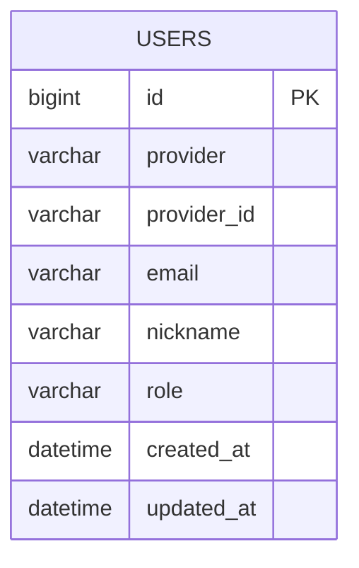

# ERD

> 최종 수정: 2026-11-05
> 현재 구현된 엔티티는 없다 (`com.sudam.domain.user.enums.Role` enum만 존재). 아래는 채워 나갈 틀이다.
> 작성 규칙은 `.claude/rules/jpa-convention.md`를 따른다.

## 전체 관계도

<!-- TODO: 엔티티가 추가되면 관계(||--o{ 등)와 테이블을 함께 갱신한다. -->

## 테이블 정의

### users (예정)

소셜 로그인으로 가입한 회원. `provider` + `provider_id` 조합이 외부 식별자.

| 컬럼 | 타입 | 제약 | 설명 |
| --- | --- | --- | --- |
| `id` | `bigint` | PK, AUTO_INCREMENT | 내부 식별자 |
| `provider` | `varchar(20)` | NOT NULL, UNIQUE(provider, provider_id) | 소셜 공급자 (`kakao` 등) |
| `provider_id` | `varchar(100)` | NOT NULL | 공급자가 부여한 회원 식별자 |
| `email` | `varchar(255)` | NOT NULL | 소셜 계정 이메일 (필수 동의 항목) |
| `nickname` | `varchar(30)` | NOT NULL | 닉네임 (필수 동의 항목) |
| `role` | `varchar(20)` | NOT NULL | `USER` / `ADMIN` (`Role` enum, STRING 저장) |
| `created_at` | `datetime` | NOT NULL | 생성 시각 |
| `updated_at` | `datetime` | NOT NULL | 수정 시각 |

<!-- TODO: 실제 엔티티 구현 시 컬럼/제약을 코드와 일치시킨다. -->

## 공통 사항

- PK는 `bigint` + `AUTO_INCREMENT` (`GenerationType.IDENTITY`).
- enum 컬럼은 문자열로 저장한다 (`@Enumerated(EnumType.STRING)`).
- 모든 테이블은 `created_at` / `updated_at`을 가진다 (`BaseTimeEntity` 상속 예정).
- 테이블명은 복수형 snake_case. `user`, `order` 같은 MySQL 예약어는 피한다.
- 스키마는 `ddl-auto: create`로 엔티티에서 생성된다. 별도 마이그레이션 스크립트는 없다.

## 삭제 정책

<!-- TODO: 하드 삭제 / 소프트 삭제(deleted_at) 방침을 정해 기록한다. -->