# ERD

> 최종 수정: 2026-11-14
> 작성 규칙은 `.claude/rules/jpa-convention.md`를 따른다.

- 기준: SUDAM 기능명세서 11-01 ver, 결제 방식 10/31 최종 정리. 괄호 속 숫자(예: 2.2.4)는 기능명세서 번호
- 규모: 9개 도메인, 40개 테이블 (UT 전 22 · UT 이후 17 · P2 1)

## 공통 규칙

- DB: MySQL 8.x. CHECK 제약은 쓰지 않고 ’앱 검증’은 서비스 · 요청 객체 검증에서 확인
- PK: BIGINT UNSIGNED AUTO_INCREMENT (코드 테이블은 SMALLINT)
- 시각: DATETIME에 한국 시간 저장. JDBC serverTimezone=Asia/Seoul, JVM 기본 타임존, MySQL time_zone = ’+09:00’을 함께 맞춤
- 문자셋: utf8mb4
- 삭제: 논리 삭제(withdrawn_at, deleted_at, removed_at) + 개인정보 · 식별값은 NULL로 파기
- 계산으로 구할 수 있는 상태(읽음, 무응답, 미기록, 회차 번호, 기간, 준비 카드 단계 완료, 이용권 만료, 구독 이용 중 · 입금 대기 · 만료 · 승인 대기, 소개서 상태)는 저장하지 않음
- 계좌번호는 애플리케이션에서 암호화해 저장 (JPA 변환기, 컬럼 길이 255). 화면에 쓰는 뒤 4자리는 따로 저장해 목록에서 복호화하지 않음
  - 구현: `com.sudam.global.crypto.AccountNumberConverter` (AES-256-GCM, 저장값 = Base64(IV 12바이트 + 암호문 + 태그)). 키는 `.env`의 `ACCOUNT_ENCRYPTION_KEY`(Base64 32바이트). 매번 새 IV라 같은 계좌번호도 암호문이 달라요
- 토큰(링크 · 수업 계획서 · 캘린더 구독)은 SecureRandom 32바이트를 URL 안전 문자열로 저장. 재발급은 새 값, 폐기는 NULL 또는 revoked_at
- ‘조건에 맞는 행은 1개만’ 규칙은 생성 컬럼 + 유일 제약으로 DB에서 보장 (cycles.in_progress_key, invoices.active_cycle_key, payment_requests.pending_key, tutoring_drafts.saved_key, calendar_subscriptions.active_key)
  - 현재 미구현: 생성 컬럼은 `ddl-auto`로 만들어지지 않아 엔티티에 두지 않았어요. 마이그레이션 도구 도입 전까지는 서비스에서 보장해요
- 설정값(DB에 두지 않음): 결제 가격, 수담 입금 계좌, 인기 선생님 소개서 건수 · 칸별 사용 비율, 수업료 예시 단가(회당 45,000원), 구독 유예 일수(7일), 구독 안내 시점(결제일 3일 전). 결제 요청에는 그때 금액을 복사해 둠
- 소개서는 선생님당 1개(다시 만들면 덮어씀). 인기 선생님 사례 데이터는 서비스 DB에 넣지 않음

## 테이블 목록

| 도메인 | 테이블 | 개발 시점 |
| --- | --- | --- |
| 계정 | users, terms, user_terms_agreements, teacher_profiles | UT 전 |
| 첫 과외 준비 | teacher_intros, teacher_intro_sections, consult_students, curricula, curriculum_stages, curriculum_textbooks | UT 이후 |
| 과외 | tutorings, tutoring_schedules, textbooks, tutoring_policies, tutoring_settings | UT 전 |
| 참여자 | participants | UT 전 |
| 수업 | cycles, sessions, makeup_requests | UT 전 |
| 수업 | teacher_events, session_time_changes, calendar_subscriptions | UT 이후 |
| 수업 | parent_requests | P2 |
| 기록 | session_records, session_progress | UT 전 |
| 기록 | session_record_revisions | UT 이후 |
| 정산 | settlement_reports, settlement_report_progress, settlement_report_views, invoices, invoice_amount_adjustments, invoice_payments | UT 전 |
| 알림 | link_shares | UT 전 |
| 알림 | notification_jobs, notification_attempts, push_tokens | UT 이후 |
| 결제 | payment_requests, curriculum_passes, subscriptions, tutoring_drafts | UT 이후 |

## 관계도

```mermaid
erDiagram
    users ||--o{ user_terms_agreements : "user_id"
    terms ||--o{ user_terms_agreements : "terms_id"
    users ||--o| teacher_profiles : "user_id"
    teacher_profiles ||--o| teacher_intros : "teacher_id"
    teacher_intros ||--o{ teacher_intro_sections : "intro_id"
    teacher_profiles ||--o{ consult_students : "teacher_id"
    tutorings ||--o| consult_students : "tutoring_id"
    teacher_profiles ||--o{ curricula : "teacher_id"
    consult_students ||--o| curricula : "consult_student_id"
    tutorings ||--o| curricula : "tutoring_id"
    curriculum_passes ||--o| curricula : "pass_id"
    curricula ||--o{ curriculum_stages : "curriculum_id"
    curricula ||--o{ curriculum_textbooks : "curriculum_id"
    teacher_profiles ||--o{ tutorings : "teacher_id"
    tutorings ||--o{ tutoring_schedules : "tutoring_id"
    tutorings ||--o{ textbooks : "tutoring_id"
    tutorings ||--o{ tutoring_policies : "tutoring_id"
    tutorings ||--o| tutoring_settings : "tutoring_id"
    users ||--o{ participants : "user_id"
    tutorings ||--o{ participants : "tutoring_id"
    participants ||--o{ participants : "guardian_consent_by"
    tutorings ||--o{ cycles : "tutoring_id"
    tutorings ||--o{ sessions : "tutoring_id"
    cycles ||--o{ sessions : "cycle_id"
    tutoring_schedules ||--o{ sessions : "schedule_id"
    sessions ||--o| makeup_requests : "canceled_session_id"
    participants ||--o{ makeup_requests : "selected_by"
    sessions ||--o| makeup_requests : "makeup_session_id"
    tutorings ||--o{ session_time_changes : "tutoring_id"
    tutoring_schedules ||--o{ session_time_changes : "schedule_id"
    sessions ||--o{ session_time_changes : "session_id"
    teacher_profiles ||--o{ teacher_events : "teacher_id"
    tutorings ||--o{ teacher_events : "tutoring_id"
    teacher_profiles ||--o{ calendar_subscriptions : "teacher_id"
    participants ||--o{ calendar_subscriptions : "participant_id"
    curricula ||--o{ calendar_subscriptions : "curriculum_id"
    tutorings ||--o{ parent_requests : "tutoring_id"
    participants ||--o{ parent_requests : "requester_id"
    sessions ||--o{ parent_requests : "target_session_id"
    makeup_requests ||--o{ parent_requests : "makeup_request_id"
    sessions ||--o| session_records : "session_id"
    sessions ||--o{ session_progress : "session_id"
    textbooks ||--o{ session_progress : "textbook_id"
    session_records ||--o{ session_record_revisions : "session_record_id"
    tutorings ||--o{ settlement_reports : "tutoring_id"
    cycles ||--o| settlement_reports : "cycle_id"
    settlement_reports ||--o{ settlement_report_progress : "report_id"
    textbooks ||--o{ settlement_report_progress : "textbook_id"
    settlement_reports ||--o{ settlement_report_views : "report_id"
    participants ||--o{ settlement_report_views : "participant_id"
    tutorings ||--o{ invoices : "tutoring_id"
    cycles ||--o{ invoices : "billed_cycle_id"
    settlement_reports ||--o{ invoices : "report_id"
    tutoring_policies ||--o{ invoices : "policy_id"
    participants ||--o{ invoices : "confirm_requested_by"
    invoices ||--o{ invoice_amount_adjustments : "invoice_id"
    invoices ||--o{ invoice_payments : "invoice_id"
    teacher_profiles ||--o{ link_shares : "teacher_id"
    tutorings ||--o{ link_shares : "tutoring_id"
    participants ||--o{ link_shares : "participant_id"
    teacher_profiles ||--o{ notification_jobs : "teacher_id"
    tutorings ||--o{ notification_jobs : "tutoring_id"
    notification_jobs ||--o{ notification_attempts : "job_id"
    push_tokens ||--o{ notification_attempts : "push_token_id"
    users ||--o{ push_tokens : "user_id"
    teacher_profiles ||--o{ payment_requests : "teacher_id"
    users ||--o{ payment_requests : "processed_by"
    consult_students ||--o{ payment_requests : "consult_student_id"
    tutoring_drafts ||--o{ payment_requests : "tutoring_draft_id"
    payment_requests ||--o| curriculum_passes : "payment_request_id"
    teacher_profiles ||--o{ curriculum_passes : "teacher_id"
    teacher_profiles ||--o| subscriptions : "teacher_id"
    teacher_profiles ||--o{ tutoring_drafts : "teacher_id"
    tutorings ||--o| tutoring_drafts : "used_tutoring_id"
```



## 1. 계정 도메인

로그인은 카카오만 지원하고 카카오 회원번호(provider_id)로 사용자를 찾아요. 비밀번호는 저장하지 않아요.

### users (회원)

| 컬럼 | 타입 | 제약 | 설명 |
| --- | --- | --- | --- |
| `id` | BIGINT UNSIGNED | PK |  |
| `role` | ENUM(‘TEACHER’,‘PARENT’,‘STUDENT’) | NOT NULL | 웹 버전은 가입하면 TEACHER로 자동 저장 (역할 선택 1.1.2는 P1) |
| `is_admin` | BOOLEAN | NOT NULL, DEFAULT FALSE | 수담 운영자. 관리자 입금 승인(11.5.4) API 권한. 값은 DB에서 직접 켬 |
| `email` | VARCHAR(255) | NULL, UNIQUE | 카카오가 제공할 때만 저장. 탈퇴 시 NULL |
| `provider` | ENUM(‘KAKAO’) | NOT NULL |  |
| `provider_id` | VARCHAR(255) | NULL | 카카오 회원번호. 탈퇴 시 NULL |
| `created_at / updated_at` | DATETIME | NOT NULL |  |
| `withdrawn_at` | DATETIME | NULL | 논리 삭제. 카카오 연결 끊기도 함께 처리 (1.2.3) |
- 제약: UNIQUE(provider, provider_id). 앱 검증: 활성 계정이면 provider_id 필수.

### terms (이용 약관)

| 컬럼 | 타입 | 제약 | 설명 |
| --- | --- | --- | --- |
| `id` | BIGINT UNSIGNED | PK |  |
| `code` | VARCHAR(20) | NOT NULL | SERVICE / PRIVACY / CONTACT |
| `version` | SMALLINT UNSIGNED | NOT NULL | 1부터. 내용이 바뀌면 새 행 |
| `title` | VARCHAR(100) | NOT NULL |  |
| `is_required` | BOOLEAN | NOT NULL | [필수] 표시 |
| `target_role` | ENUM(‘TEACHER’,‘PARENT’,‘STUDENT’) | NULL | NULL = 전체 |
| `effective_at` | DATETIME | NOT NULL | 시행 시각. 시행 후 미동의 사용자는 재동의 화면 |
- 제약: UNIQUE(code, version).

### user_terms_agreements (회원 약관 동의)

| 컬럼 | 타입 | 제약 | 설명 |
| --- | --- | --- | --- |
| `id` | BIGINT UNSIGNED | PK |  |
| `user_id` | BIGINT UNSIGNED | FK → users |  |
| `terms_id` | BIGINT UNSIGNED | FK → terms | 버전별 행을 가리킴 |
| `agreed_at` | DATETIME | NOT NULL | 동의 일시 (1.1.3) |
| `withdrawn_at` | DATETIME | NULL | 선택 약관 철회 |
- 제약: UNIQUE(user_id, terms_id).

### teacher_profiles (선생님 프로필)

| 컬럼 | 타입 | 제약 | 설명 |
| --- | --- | --- | --- |
| `user_id` | BIGINT UNSIGNED | PK, FK → users | 1:1 |
| `name` | VARCHAR(10) | NOT NULL | 2~10자. 결제 입금자명 기본값 (11.5.1) |
| `subjects` | JSON | NOT NULL | 담당 과목 복수 선택 (1.1.4). 과목 코드 배열 `["ENGLISH","MATH"]` |
| `subject_other` | VARCHAR(20) | NULL | subjects에 OTHER가 있을 때 직접 입력한 과목명 |
| `onboarding_stage` | ENUM(‘PREPARING’,‘TEACHING’) | NOT NULL | 가입 마지막 단계 선택 (1.1.5). 첫 과외 준비 / 이미 과외 중 |
| `first_tutoring_created_at` | DATETIME | NULL | 처음 과외를 만든 시각. 탭 잠금 해제 기준 (11.1.2). 과외를 모두 종료 · 삭제해도 지우지 않음 |
| `intro_unlocked_at` | DATETIME | NULL | 소개서 전문 열림 = 묶음 결제 승인 시각 (11.5.4) |
| `prep_card_hidden_at` | DATETIME | NULL | 준비 카드 ✕ 시각 (11.1.1). 4/4 완료 전에는 숨길 수 없음(앱 검증) |
| `created_at / updated_at` | DATETIME | NOT NULL |  |
- 탭 잠금(11.1.2) = onboarding_stage = PREPARING AND first_tutoring_created_at IS NULL. 서버가 판단해 내려줘요.
- 소개서 상태(1.2.5) = 전문 열림(intro_unlocked_at 있음) / 승인 대기(묶음 결제 요청 PENDING) / 진단만 봄(teacher_intros 행 있음) / 없음. 저장하지 않고 계산해요.
- 과목 코드는 테이블 없이 애플리케이션 enum(ENGLISH 영어 · MATH 수학 · KOREAN 국어 · SCIENCE 과학 · SOCIAL 사회 · OTHER 기타)으로 두고, 각 테이블에 코드 문자열로 저장해요. 기타 과목은 각 테이블의 subject_other에 직접 입력해요.

## 2. 첫 과외 준비 도메인

소개서 → 학생 정보 → 커리큘럼 → 과외 등록 4단계(11.0.0)를 맡아요. 준비 카드의 단계별 완료는 저장하지 않고 아래처럼 계산해요 (11.1.1 완료 조건).

| 단계 | 완료 조건 |
| --- | --- |
| ① 소개서 만들기 | teacher_profiles.intro_unlocked_at IS NOT NULL (소개서 전문 승인) |
| ② 학생 정보 넣기 | 삭제되지 않은 curricula 행 1개 이상 (커리큘럼을 받음) 또는 커리큘럼으로 만든 과외(curricula.tutoring_id 있음) |
| ③ 커리큘럼 받기 | curricula.handed_off_at IS NOT NULL ([이 커리큘럼으로 과외 만들기]를 누름) 또는 커리큘럼으로 만든 과외 |
| ④ 과외 만들기 | curricula.tutoring_id IS NOT NULL인 행 1개 이상 (커리큘럼으로 만든 과외 저장) |

명세 문구상 ②의 완료가 ’커리큘럼을 받음’이라 ②와 ③이 거의 같이 끝나요. 표시는 명세 그대로 따라요.

### teacher_intros (소개서)

`UT 이후`

| 컬럼 | 타입 | 제약 | 설명 |
| --- | --- | --- | --- |
| `id` | BIGINT UNSIGNED | PK |  |
| `teacher_id` | BIGINT UNSIGNED | NOT NULL, UNIQUE, FK → teacher_profiles | 선생님당 1개. 다시 만들면 칸 내용을 덮어씀 |
| `school_major` | VARCHAR(24) | NOT NULL | 학교 · 전공 1~24자 (공백만이면 빈 값) |
| `inputs` | JSON | NOT NULL | 칩 입력 6그룹. {“currentStatus”:{code, other}, “targetLevel”:{…}, “fitStudent”:{…}, “experience”:{…}, “strengths”:[{code, other}…], “style”:{…}}. 각 그룹 끝 [기타]는 other 1~20자 |
| `achievement_line` | VARCHAR(80) | NULL | 성과 · 내 경험 한 줄 (선택) |
| `length_mode` | ENUM(‘SHORT’,‘NORMAL’) | NOT NULL, DEFAULT ‘NORMAL’ | 짧게 · 핵심 5칸 / 보통 · 8칸 (11.2.4) |
| `ai_status` | ENUM(‘PENDING’,‘DONE’,‘FAILED’) | NULL | 생성 중 / 완료 / 실패(입력값 유지 + [다시 시도]) |
| `diagnosed_at` | DATETIME | NULL | 처음 생성 성공 시각 = 무료 진단 완료 (11.2.3) |
| `generated_at` | DATETIME | NULL | 마지막 생성 시각 |
| `copied_at` | DATETIME | NULL | 마지막 [복사하기] 시각. 준비 카드 완료 조건에서는 빠짐 |
| `created_at / updated_at` | DATETIME | NOT NULL |  |
- 입력 코드: currentStatus = ENROLLED · ON_LEAVE · GRADUATED, targetLevel = ELEMENTARY · MIDDLE · HIGH, fitStudent = BASICS · LOWER_TO_MIDDLE · TOP_KEEP · SCHOOL_EXAM · SUNEUNG, experience = NONE · MENTORING · ACADEMY_ASSISTANT · ACADEMY_TEACHER, strengths(1~2개) = GRADES · EASY_EXPLAIN · EXAM_ANALYSIS · HOMEWORK_CARE · DIAGNOSIS · OWN_STRUGGLE, style = CONCEPT · PROBLEM · SCHOOL_EXAM · SUNEUNG. 모든 그룹에 OTHER(기타). 강점에서는 기타도 2개 중 1개로 셈.
- 과목 · 이름은 프로필 값을 써요. 인공지능에는 연락처 · 실명을 보내지 않아요.

### teacher_intro_sections (소개서 칸)

`UT 이후`

| 컬럼 | 타입 | 제약 | 설명 |
| --- | --- | --- | --- |
| `id` | BIGINT UNSIGNED | PK |  |
| `intro_id` | BIGINT UNSIGNED | NOT NULL, FK → teacher_intros |  |
| `section_key` | ENUM(‘HEADLINE’,‘ABOUT’,‘STYLE’,‘FIT’,‘CURRICULUM’,‘CARE’,‘PROOF’,‘GUIDE’) | NOT NULL | 8칸: 한 줄 소개 · 선생님 소개 · 수업 방식 · 잘 맞는 학생 · 커리큘럼 · 교재 · 관리 방식 · 성과 · 내 경험 · 수업 안내 · 상담 |
| `sort_order` | TINYINT UNSIGNED | NOT NULL | 1~8 |
| `body` | TEXT | NOT NULL | 지금 본문 (선생님이 고치면 바뀜) |
| `is_ai_draft` | BOOLEAN | NOT NULL, DEFAULT TRUE | ‘AI 초안’ 배지. [고치기] → [완료]하면 FALSE |
| `fill_status` | ENUM(‘FILLED’,‘SUDAM_FILLS’,‘BETTER_IF_WRITTEN’) | NOT NULL | 진단 배지: 채움 / 수담이 채워요 / 쓰면 더 좋아요 (11.2.2 규칙) |
| `updated_at` | DATETIME | NOT NULL |  |
- 제약: UNIQUE(intro_id, section_key).
- 결제 승인 전(intro_unlocked_at NULL)에는 관리 방식(CARE) 칸 본문만 내려주고 나머지 7칸 본문은 응답에 넣지 않아요 (11.2.3 ‘블러 칸 실제 본문은 클라이언트로 보내지 않음’). 관리 방식 칸이 없으면 첫 칸을 공개해요.
- 짧게(SHORT) = HEADLINE · ABOUT · STYLE · CARE · GUIDE 5칸.
- 칸별 사용 비율(%)과 인기 선생님 소개서 건수 N은 설정값이에요.

### consult_students (상담 학생 정보)

`UT 이후`

| 컬럼 | 타입 | 제약 | 설명 |
| --- | --- | --- | --- |
| `id` | BIGINT UNSIGNED | PK |  |
| `teacher_id` | BIGINT UNSIGNED | NOT NULL, FK → teacher_profiles |  |
| `student_name` | VARCHAR(10) | NULL | 1~10자 (필수, 앱 검증). 삭제 시 NULL |
| `grade_level` | TINYINT UNSIGNED | NOT NULL | tutorings와 같은 규칙. 6~12 = 초6~고3, 0 = 기타 |
| `grade_other` | VARCHAR(20) | NULL | 학년 ‘기타’ 직접 입력 |
| `grade_school_year` | SMALLINT UNSIGNED | NOT NULL | 학년 기준 학년도 |
| `subject` | VARCHAR(20) | NOT NULL | 과목 코드 (ENGLISH … OTHER) |
| `subject_other` | VARCHAR(20) | NULL | 과목 ‘기타’ (11.3.1은 20자) |
| `current_level` | ENUM(‘TOP’,‘UPPER_MIDDLE’,‘MIDDLE’,‘LOWER’,‘OTHER’) | NOT NULL | 지금 성적 4단계 + 기타 (상위권 · 중상위권 · 중위권 · 하위권) |
| `current_level_other` | VARCHAR(20) | NULL |  |
| `goal` | ENUM(‘SCHOOL_EXAM’,‘SUNEUNG’,‘ADVANCE’,‘BASICS’,‘OTHER’) | NOT NULL | 내신 대비 / 수능 대비 / 선행 / 기초 다지기 / 기타 |
| `goal_other` | VARCHAR(20) | NULL |  |
| `upcoming_exam` | VARCHAR(50) | NULL | 다가오는 시험 (선택) |
| `period_label` | VARCHAR(20) | NOT NULL | 기간 칩(1개월 · 3개월 · 6개월 · 1년) 또는 기타 입력 |
| `period_weeks` | TINYINT UNSIGNED | NOT NULL | 계산용 주 수. 1개월 4 · 3개월 12 · 6개월 24 · 1년 48. 기타는 숫자를 읽어 계산(‘2개월’ → 8), 못 읽으면 12 |
| `frequency_label` | VARCHAR(20) | NOT NULL | 수업 횟수 칩(주 1~3회) 또는 기타 입력 |
| `lessons_per_week` | TINYINT UNSIGNED | NOT NULL | 계산용 주 n회. 기타는 숫자를 읽음(‘주 4회’ → 4), 못 읽으면 2 |
| `consult_memo` | TEXT | NULL | 상담 메모. 학부모 · 학생에게 공개하지 않음 |
| `tutoring_id` | BIGINT UNSIGNED | NULL, UNIQUE, FK → tutorings | 11.4.3으로 과외를 등록하면 연결 |
| `created_at / updated_at` | DATETIME | NOT NULL |  |
| `deleted_at` | DATETIME | NULL | 논리 삭제 |
- 앱 검증: 필수 7개(이름 · 학년 · 과목 · 성적 · 목표 · 기간 · 횟수). 칩 그룹 6개의 [기타]는 입력칸이 채워져야 선택으로 봐요. subject = OTHER일 때만 subject_other 필수.
- 카톡 캡처(11.3.1)는 글자만 읽어 consult_memo에 넣고 이미지는 저장하지 않아요.

### curricula (커리큘럼)

`UT 이후`

| 컬럼 | 타입 | 제약 | 설명 |
| --- | --- | --- | --- |
| `id` | BIGINT UNSIGNED | PK |  |
| `teacher_id` | BIGINT UNSIGNED | NOT NULL, FK → teacher_profiles |  |
| `consult_student_id` | BIGINT UNSIGNED | NULL, UNIQUE, FK → consult_students | 상담 학생 1명당 커리큘럼 1개. 같은 학생 [다시 만들기]는 덮어씀 (이용권 추가 차감 없음) |
| `tutoring_id` | BIGINT UNSIGNED | NULL, UNIQUE, FK → tutorings | 이미 과외 중인 학생(7.2.3)이거나 11.4.3 등록 후 |
| `pass_id` | BIGINT UNSIGNED | NULL, UNIQUE, FK → curriculum_passes | 처음 생성할 때 쓴 이용권 (11.5.3) |
| `goal` | VARCHAR(100) | NULL | 목표 한 줄 |
| `total_weeks / lessons_per_week / minutes_per_lesson` | TINYINT UNSIGNED / TINYINT UNSIGNED / SMALLINT UNSIGNED | NOT NULL | 상담 학생 정보에서 계산 (한 번 90분 기본). 총 회차 = 주 수 × 주 n회 |
| `lesson_structure` | JSON | NULL | 한 번 수업 구성 [{“part”:“숙제 확인”,“minutes”:10}, …] |
| `suggestion` | JSON | NULL | 과외 만들기 미리 채움: 요일 · 시간(18:00–19:30) · 정산 회차(min(8, 주 n회 × 4)) · 선불 · 수업료 예시 |
| `memo_reflections` | JSON | NULL | 상담 메모 반영 문구 목록 (✓ 목록) |
| `ai_status` | ENUM(‘PENDING’,‘DONE’,‘FAILED’) | NULL |  |
| `is_ai_draft` | BOOLEAN | NOT NULL, DEFAULT TRUE | ‘AI 초안’ 표시. 선생님이 고치면 FALSE |
| `handed_off_at` | DATETIME | NULL | [이 커리큘럼으로 과외 만들기]를 누른 시각 (준비 카드 ③) |
| `plan_token` | VARCHAR(64) | NULL, UNIQUE | 수업 계획서 링크 토큰. 폐기하면 NULL |
| `plan_token_issued_at` | DATETIME | NULL |  |
| `plan_shared_at` | DATETIME | NULL | 마지막 공유 시각. updated_at이 더 늦으면 ‘선생님이 계획을 수정했어요’ (9.2.5) |
| `created_at / updated_at` | DATETIME | NOT NULL |  |
| `deleted_at` | DATETIME | NULL | 논리 삭제. plan_token도 NULL |
- 앱 검증: consult_student_id와 tutoring_id 중 하나 이상. 과외를 만든 뒤(tutoring_id 있음)에는 읽기 전용 (11.4.2, 수정은 P1).
- 수업 계획서 토큰을 참여자 링크와 따로 둔 이유는 상담 단계에서는 학부모가 아직 참여자가 아니기 때문이에요(9.2.5, 11.4.4). 계획서 화면에는 교육비 · 연락처 · 상담 메모를 넣지 않아요.

### curriculum_stages (커리큘럼 단계)

`UT 이후`

| 컬럼 | 타입 | 제약 | 설명 |
| --- | --- | --- | --- |
| `id` | BIGINT UNSIGNED | PK |  |
| `curriculum_id` | BIGINT UNSIGNED | NOT NULL, FK → curricula |  |
| `sort_order` | TINYINT UNSIGNED | NOT NULL | 1부터 |
| `weeks` | TINYINT UNSIGNED | NOT NULL | 단계 길이(주). 4단계 비율 17% · 40% · 25% · 나머지 (11.4.1) |
| `period_label` | VARCHAR(20) | NOT NULL | 기간 (예: 1~2주) |
| `name` | VARCHAR(30) | NOT NULL | 단계 이름 (예: 진단과 개념) |
| `content` | VARCHAR(200) | NOT NULL | 단계 내용 ([고치기] 대상) |
| `progress_text` | VARCHAR(50) | NULL | 교재 · 진도 (예: 개념원리 1~3단원) |
- 제약: INDEX(curriculum_id, sort_order). P0는 4단계 고정, 단계 추가 · 삭제는 P1 (11.4.2). 내용을 모두 지우면 이전 내용 유지(앱 검증).

### curriculum_textbooks (커리큘럼 교재)

`UT 이후`

| 컬럼 | 타입 | 제약 | 설명 |
| --- | --- | --- | --- |
| `id` | BIGINT UNSIGNED | PK |  |
| `curriculum_id` | BIGINT UNSIGNED | NOT NULL, FK → curricula |  |
| `name` | VARCHAR(20) | NOT NULL | 교재명 |
| `role` | ENUM(‘MAIN_CANDIDATE’,‘SUB’) | NOT NULL | 주교재 후보(AI 추천 2개) / 부교재 |
| `is_selected` | BOOLEAN | NOT NULL, DEFAULT FALSE | 고른 주교재 (후보 중 1개만, 앱 검증) |
| `progress_unit` | ENUM(‘UNIT’,‘SECTION’,‘CHAPTER’,‘PAGE’,‘ROUND’,‘CUSTOM’) | NOT NULL | 영어는 UNIT, 그 외 SECTION(단원) |
| `custom_unit_label` | VARCHAR(5) | NULL |  |
| `sort_order` | TINYINT UNSIGNED | NOT NULL |  |
- 11.4.3으로 과외를 등록하면 고른 주교재를 textbooks로 넘기고 시작 진도 = 1이에요. 교재 DB에 없는 과목은 ‘OO 기본서 / 문제집 / 실전서’. 교재 내용 · 목차는 저장하지 않아요(저작권).

## 3. 과외 도메인

과외 1개 = 학생 1명. 수업료 · 정산 회차 · 선불/후불 · 휴강 규칙은 사이클 기준 이력(tutoring_policies)으로 저장해요. 수업 일정은 적용 기간이 있는 반복 규칙이에요.

### tutorings (과외)

| 컬럼 | 타입 | 제약 | 설명 |
| --- | --- | --- | --- |
| `id` | BIGINT UNSIGNED | PK |  |
| `teacher_id` | BIGINT UNSIGNED | FK → teacher_profiles |  |
| `subject` | VARCHAR(20) | NOT NULL | 과목 코드 (ENGLISH … OTHER) |
| `subject_other` | VARCHAR(10) | NULL | 과목 ‘기타’ 1~10자. subject = OTHER일 때만 |
| `student_name` | VARCHAR(10) | NULL | 1~10자. 삭제 시 NULL |
| `grade_level` | TINYINT UNSIGNED | NOT NULL | 1~12 = 초1~고3 (화면 선택지는 초6~고3), 0 = 기타. 현재 학년 = grade_level + (올해 학년도 − grade_school_year), 12에서 멈춤. 1~8이면 자녀 동의 필요, 0(기타)은 필요 없음 |
| `grade_other` | VARCHAR(10) | NULL | 학년 ‘기타’ 직접 입력 (예: 재수생, 성인) |
| `grade_school_year` | SMALLINT UNSIGNED | NOT NULL | 학년 기준 학년도 (3~12월은 그해, 1~2월은 전년도) |
| `status` | ENUM(‘ACTIVE’,‘ENDED’) | NOT NULL | 진행 중 / 종료 |
| `ended_at` | DATETIME | NULL | 수업 종료 (7.1.2) |
| `created_at / updated_at` | DATETIME | NOT NULL |  |
| `deleted_at` | DATETIME | NULL | 논리 삭제 |
- 제약: INDEX(teacher_id, status). 앱 검증: subject = OTHER일 때만 subject_other 필수, grade_level = 0이면 grade_other 필수.
- 구독 판단(1.2.2): ‘수업 중’ 과외 수 = status = ACTIVE이고 deleted_at IS NULL인 행 수. 1개 이상인데 구독이 ‘이용 중’ 또는 ‘입금 대기(유예)’가 아니면 새 과외를 만들 수 없어요. 구독이 만료돼도 기존 과외의 기록 · 정산 · 학부모 링크는 그대로예요.
- 구현 메모 (팀 결정, 위 표보다 우선): `teacher_id`는 `TeacherProfile` 연관관계(`@ManyToOne(LAZY)`)예요. `teacher_profiles`의 PK가 `users.id`라 값은 그대로 `users.id`예요. 과목은 표대로 `subject` 컬럼에 `Subject` enum 이름을 `@Enumerated(STRING)`으로 저장해요. 프로필과 같은 enum(`com.sudam.domain.user.enums.Subject`)을 써요. 예전 임시 컬럼 `subject_id`는 쓰지 않아요.
- 공통 구현 메모 (과외 · 참여자 도메인): UNSIGNED는 붙이지 않았어요(`users`와 같음). ENUM 컬럼은 `@Enumerated(STRING)`이라 Hibernate가 MySQL ENUM으로 만들어요.

### tutoring_schedules (수업 일정)

| 컬럼 | 타입 | 제약 | 설명 |
| --- | --- | --- | --- |
| `id` | BIGINT UNSIGNED | PK |  |
| `tutoring_id` | BIGINT UNSIGNED | FK → tutorings |  |
| `day_of_week` | TINYINT UNSIGNED | NOT NULL | 1(월)~7(일) |
| `start_time / end_time` | TIME | NOT NULL | 10분 단위, 하루 안에서만 |
| `effective_from` | DATE | NOT NULL | 적용 시작일 (과외 생성일 또는 변경일) |
| `effective_to` | DATE | NULL | 적용 종료일. NULL = 현재 적용 중 |
| `created_at` | DATETIME | NOT NULL |  |
- 제약: INDEX(tutoring_id, effective_to). 요일을 바꾸면 기존 행의 effective_to를 채우고 새 행을 추가해요(요일 변경은 P1).
- 앱 검증: start_time < end_time, 같은 과외 · 같은 요일의 적용 기간이 겹치지 않음. P0에서 일정 없는 과외는 만들 수 없어요 (2.2.1, 요일 1개 이상 필수). 첫 수업 = 저장일 이후 첫 수업 요일.

### textbooks (교재)

| 컬럼 | 타입 | 제약 | 설명 |
| --- | --- | --- | --- |
| `id` | BIGINT UNSIGNED | PK |  |
| `tutoring_id` | BIGINT UNSIGNED | FK → tutorings |  |
| `name` | VARCHAR(20) | NOT NULL | 교재명 |
| `progress_unit` | ENUM(‘UNIT’,‘SECTION’,‘CHAPTER’,‘PAGE’,‘ROUND’,‘CUSTOM’) | NOT NULL | Unit / 단원 / Chapter / 페이지 / 회 / 기타 |
| `custom_unit_label` | VARCHAR(5) | NULL | CUSTOM일 때 단위 이름 1~5자 (예: 강, 과, 세트) |
| `start_position` | SMALLINT UNSIGNED | NOT NULL, DEFAULT 0 | 지금 진도. 비우면 0이고 첫 기록 제안 칩은 1부터 (2.1.2) |
| `ended_at` | DATETIME | NULL | 사용 종료 (P1) |
| `created_at` | DATETIME | NOT NULL |  |
- 앱 검증: 과외당 1~5권. 진도는 모든 단위(기타 포함)에서 숫자 범위로 저장하고 ’단위 + 숫자’로 표시 (2.1.2, 4.1.2). 교재 내용 · 목차는 저장하지 않음(저작권).

### tutoring_policies (과외 정책 이력)

| 컬럼 | 타입 | 제약 | 설명 |
| --- | --- | --- | --- |
| `id` | BIGINT UNSIGNED | PK |  |
| `tutoring_id` | BIGINT UNSIGNED | FK → tutorings |  |
| `effective_cycle_no` | INT UNSIGNED | NOT NULL | 적용 시작 사이클 번호 |
| `settlement_session_cnt` | TINYINT UNSIGNED | NOT NULL | 정산 회차 1~20 (2.2.2 · 2.2.4 화면 기준) |
| `payment_timing` | ENUM(‘PREPAID’,‘POSTPAID’) | NOT NULL | 선불 / 후불 |
| `tuition_fee` | INT UNSIGNED | NOT NULL | 정산 단위(사이클) 1번의 수업료 10,000~10,000,000원 |
| `same_day_cancel_recognized` | BOOLEAN | NOT NULL, DEFAULT FALSE | 학생 당일 취소 인정 여부 |
| `bank_code` | CHAR(3) | NULL | 은행 코드 (금융결제원 3자리). ’기타’면 NULL |
| `bank_name` | VARCHAR(20) | NOT NULL | 은행 이름. 목록 이름 또는 ‘기타’ 직접 입력 1~20자 (예: 증권사 CMA) |
| `account_number` | VARCHAR(255) | NOT NULL | 계좌번호 암호문. 원문은 숫자 10~14자리 (하이픈 입력 허용, 저장은 숫자만) |
| `account_last4` | CHAR(4) | NOT NULL | 계좌번호 뒤 4자리. ‘국민 ****1492 한서윤’ 표시용 |
| `account_holder` | VARCHAR(20) | NOT NULL | 예금주 1~20자 (기본값: 선생님 이름) |
| `created_at` | DATETIME | NOT NULL |  |
- 제약: INDEX(tutoring_id, effective_cycle_no, id).
- 사이클 N의 정책 = effective_cycle_no ≤ N인 행 중 가장 최근 것 (같으면 id가 큰 행). 구현: 레포지토리로 과외의 정책 목록을 읽고 순수 함수 `TutoringPolicies.applicableTo(policies, N)`으로 골라요. 해당 행이 없으면 빈 값.
- 구현 메모: `same_day_cancel_recognized`는 컬럼만 두고 P0에서는 항상 false로 생성해요(팀 결정). `bank_code`는 은행 목록에 없는 이름이면 NULL, `bank_name`에 입력값을 그대로 둬요. 이름 → 코드 변환은 API 작업에서 해요.
- 수정(2.5.1): P0는 수업료만, 다음 사이클부터. 다음 사이클에 적용될 예정 행이 이미 있으면 새 행을 만들지 않고 그 행을 덮어써요 (‘예정 이력 1줄’). 정산 회차 · 선불/후불 · 당일 취소 규칙 · 계좌 수정은 P1.
- 은행 목록(2.2.4): 국민 004 · 신한 088 · 우리 020 · 하나 081 · 농협 011 · 기업 003 · SC제일 023 · 씨티 027 · 카카오뱅크 090 · 토스뱅크 092 · 케이뱅크 089 · iM뱅크(대구) 031 · 부산 032 · 경남 039 · 광주 034 · 전북 037 · 제주 035 · 수협 007 · 산업 002 · 새마을금고 045 · 신협 048 · 우체국 071 · 저축은행 050 · 산림조합 064 · 기타(NULL).
- 계좌번호 전체는 선생님 본인과 학부모 교육비 화면([계좌 복사])에만 내려줘요. 목록 · 리포트 · 학생 상세는 뒤 4자리만. 실제 청구에 쓴 계좌는 invoices에 복사해요.

### tutoring_settings (공유 설정)

| 컬럼 | 타입 | 제약 | 설명 |
| --- | --- | --- | --- |
| `tutoring_id` | BIGINT UNSIGNED | PK, FK → tutorings | 1:1 |
| `preset_type` | ENUM(‘THOROUGH’,‘SIMPLE’,‘MINIMAL’) | NULL | 프리셋 유형 꼼꼼형 · 간단형 · 최소형 (2.3.1, 서버 · 프론트 같은 판정). [건너뛰기]는 SIMPLE |
| `parent_update_frequency` | ENUM(‘EVERY_SESSION’,‘AT_SETTLEMENT’,‘NONE’) | NOT NULL | 학부모 근황: 매 수업 후 / 정산 때만 / 보내지 않음 |
| `homework_notify_enabled` | BOOLEAN | NOT NULL | 학생 숙제 알림 켜기 · 끄기. 받는 사람은 학생만 (2.3.2). 학생 번호가 없으면 켜지 않음 |
| `unpaid_reminder_enabled` | BOOLEAN | NOT NULL, DEFAULT FALSE | 미입금 알림 (전날 9시, 선생님께, 6.3.2) |
| `updated_at` | DATETIME | NOT NULL |  |
- 기록 항목 · 학부모 공개 항목 설정은 P2(4.2.5)예요. P0는 아래 고정값을 써요.
- P0 고정값 (2.3.2): 이해도 필수 · 태도 없음. 근황에는 이해도 · 지난 숙제 · 다음 숙제를 공개하고, 관찰 한 줄은 선생님이 쓴 문장 그대로 근황 ‘선생님 한 줄’에 공개. 정산 리포트에서는 관찰 메모 원문을 학부모에게 보여주지 않아요(6.2.2).

## 4. 참여자 도메인

참여자(과외 소속)와 사용자(계정)를 분리하고 앱 가입 때 user_id만 연결해요. 카드마다 같은 링크 주소(/l/{token}/…)를 넣어야 해서 링크 토큰은 원문으로 저장해요.

### participants (과외 참여자)

| 컬럼 | 타입 | 제약 | 설명 |
| --- | --- | --- | --- |
| `id` | BIGINT UNSIGNED | PK |  |
| `user_id` | BIGINT UNSIGNED | NULL, FK → users | 앱 가입 시 연결 (P1) |
| `tutoring_id` | BIGINT UNSIGNED | FK → tutorings |  |
| `role` | ENUM(‘PARENT’,‘STUDENT’) | NOT NULL | 학부모 최대 2, 학생 1 (앱 검증) |
| `label` | ENUM(‘MOTHER’,‘FATHER’,‘GUARDIAN’) | NULL | 어머님 / 아버님 / 보호자님 (2.4.1 호칭, 선택하지 않으면 GUARDIAN). 학부모만 |
| `phone` | VARCHAR(11) | NULL | 학부모 필수 · 학생 선택 (2.4.1). 삭제 시 NULL |
| `link_token` | VARCHAR(64) | NULL, UNIQUE | 링크 토큰 원문. 재발급은 덮어쓰기, 폐기는 NULL |
| `link_issued_at` | DATETIME | NULL | 발급 · 재발급 시각 |
| `link_expires_at` | DATETIME | NULL | 진행 중에는 NULL. 수업 종료 시 종료일 + 30일 |
| `receive_method` | ENUM(‘LINK’,‘APP’,‘NONE’) | NOT NULL, DEFAULT ‘LINK’ | LINK = 링크 / APP = 앱 (P1) / NONE = 받지 않음 |
| `notification_consent` | ENUM(‘PENDING’,‘AGREED’,‘REJECTED’) | NOT NULL, DEFAULT ‘PENDING’ | 첫 입장 수신 동의 (9.1.2). PENDING = ‘초대 수락 대기’ |
| `notification_consent_at` | DATETIME | NULL | 동의 · 거부 시각. AGREED로 바뀔 때 선생님 ‘초대 수락’ 푸시 + 발송 기록 ‘초대 수락’(열람) |
| `guardian_consent_at` | DATETIME | NULL | 자녀 알림 동의 (STUDENT 행) |
| `guardian_consent_by` | BIGINT UNSIGNED | NULL, FK → participants | 동의한 학부모 (STUDENT 행) |
| `created_at / updated_at` | DATETIME | NOT NULL |  |
| `removed_at` | DATETIME | NULL | 논리 삭제. link_token도 NULL |
- 제약: INDEX(tutoring_id, role), UNIQUE(tutoring_id, user_id). 앱 검증: PARENT면 phone 필수, guardian_consent_*는 STUDENT만. 과외 만들기 때 학부모 1명은 필수(2.4.1). 두 번째 학부모는 링크 관리(7.1.4)에서 추가.
- 링크 열기 순서 (9.1.1): 토큰으로 참여자 조회 → 만료 · 삭제 · 과외 삭제 확인 → 처음이면 수신 동의 → 역할별 화면. 종료된 과외는 link_expires_at까지 보기만 가능.
- 본인 인증(문자 인증)은 하지 않아요. 링크 토큰이 곧 열쇠예요. 보완: 추측할 수 없는 토큰, 재발급 · 폐기, 수업 종료 30일 후 만료, 링크 페이지 noindex · Referrer-Policy: no-referrer, 처음 열림 알림(초대 수락), 없는 토큰 반복 요청 제한(레디스).
- 링크 재발급 · 참여자 삭제 때 그 참여자의 캘린더 구독(calendar_subscriptions)도 함께 폐기해요 (9.2.3).
- 받는 사람 상태(7.2.2)는 계산해요. 학부모: 링크로 보는 중(AGREED) / 초대 수락 대기(PENDING) / 수신 거부(REJECTED). 학생: 링크로 보는 중 / 초대 안 함(번호 없음) / 자녀 동의 대기(학년 1~8이고 guardian_consent_at NULL). 받지 않음 = NONE.

## 5. 수업 도메인

**예정 회차는 저장하지 않고 tutoring_schedules로 매번 계산해요.** 기록 · 휴강 · 보강 · 추가 · 시간 변경이 생긴 회차만 sessions에 저장해요. 8주치 사전 생성과 매일 배치는 없어요.

예정 회차 계산: 적용 기간 안에서 요일이 맞는 날짜를 만들고, 같은 (schedule_id, original_date)의 sessions 행이 있는 날짜는 그 행으로 바꿔요. 일정 탭(5.1.1), 수업 카드(3.1.1), 미기록(4.3.3), 기록 알림(3.1.2), 보강 후보 검사(5.2.2), 시간 바꾸기 검사(5.2.4), 캘린더 구독 피드(5.1.2 · 9.2.3)가 모두 이 계산기 하나를 써요.

| 상황 | sessions에 생기는 행 |
| --- | --- |
| 반복 일정 수업을 기록 | schedule_id + original_date, status = COMPLETED |
| 반복 일정 수업을 휴강 | schedule_id + original_date, status = CANCELED |
| 4.1.1 [그 수업으로] (±3일 연결) | original_date = 예정일, session_date = 기록 날짜 |
| 4.1.1 [추가 회차로] | session_type = EXTRA, schedule_id = NULL |
| 보강 확정 (학부모가 후보 선택) | session_type = MAKEUP, status = SCHEDULED, schedule_id = NULL |
| 수업 시간 바꾸기 (5.2.4, P0) | 반복 일정 회차면 schedule_id + original_date, session_date = original_date, status = SCHEDULED, start_time · end_time = 바뀐 시각, time_changed_at. 이미 저장된 회차(보강 등)면 그 행의 시각만 바꿈 |
| 날짜 이동 | 없음. 날짜까지 바꾸면 휴강 + 보강으로 처리 (5.2.4 비고) |
| 요일 변경 (P1) | sessions 변화 없음. 기존 일정 행에 effective_to, 새 일정 행 추가 |

### 회차 · 사이클 계산 규칙

명세 ‘회차 세기’(날짜순으로 인정 회차를 하나씩, 미인정 휴강은 건너뜀)를 아래 규칙으로 계산해요. 번호 · 기간 · 소속은 모두 저장하지 않아요.

1. **정렬 기준**: session_date → start_time(NULL은 뒤로) → id. 같은 날 정규 · 보강 · 추가 회차가 겹쳐도 순서가 고정돼요. 모든 번호 · 기간 · 예정 계산이 이 순서를 써요.
2. **회차 번호**: 인정 회차(is_recognized = TRUE)만 대상.

```sql
SELECT id, session_date,
  ROW_NUMBER() OVER (PARTITION BY cycle_id
    ORDER BY session_date, start_time IS NULL, start_time, id) AS no_in_cycle,
  ROW_NUMBER() OVER (
    ORDER BY session_date, start_time IS NULL, start_time, id) AS no_total
FROM sessions
WHERE tutoring_id = ? AND is_recognized = TRUE;
```

1. **사이클 기간**: 사이클 k = (사이클 k−1의 마지막 인정 날짜, 사이클 k의 마지막 인정 날짜]. 진행 중 사이클은 마지막 정산 사이클의 마지막 인정 날짜 다음 날부터예요. 화면 표기(1회차 날짜 ~ 마지막 회차 날짜)는 cycle_id별 MIN · MAX(session_date).
2. **소속 사이클**: cycle_id가 있는 행은 그 값. 미인정 휴강처럼 cycle_id가 NULL인 행은 3의 기간으로 판단해요.
3. **정산 회차를 줄였을 때** (2.5.1 ‘이번 사이클부터’): 인정 회차가 새 정산 회차보다 많으면 즉시 정산하면서, 정렬 기준으로 정산 회차번째 다음 회차들의 cycle_id를 새 사이클로 옮겨요. 옮긴 수가 새 사이클 정산 회차 이상이면 정산을 반복해요.
4. **미기록 범위** (4.3.3): 예정 회차 중 날짜가 ‘마지막 정산 사이클의 마지막 인정 날짜’ 이후이고 오늘 이전인 것만 미기록이에요. 그 이전 날짜는 기록 · 휴강이 막혀 있으니(4.1.1) 미기록에서도 빼요. 과외 생성일과 일정 effective_from 이전 날짜도 빼요.
5. **예정 회차의 사이클 예측** (5.1.1): 남은 회차 = 정산 회차 − 진행 중 사이클 인정 수. 오늘 이후 예정 회차(계산) + 저장된 SCHEDULED 행을 정렬 기준으로 세어, 남은 회차를 넘으면 다음 사이클이에요. 다음 사이클의 정산 회차는 tutoring_policies 이력으로 정해요.

명세 예시(8회차 정산)를 행으로 옮기면 이래요.

| 순서 | sessions 행 | is_recognized | cycle_id | 사이클 안 번호 |
| --- | --- | --- | --- | --- |
| 1~6번째 수업 | 정규 COMPLETED | TRUE | 1 | 1~6 |
| 7번째 예정일 | 정규 CANCELED (미인정) | FALSE | NULL (기간상 사이클 1) | 세지 않음 |
| 다음 정규 | 정규 COMPLETED | TRUE | 1 | 7 |
| 그다음 정규 | 정규 COMPLETED | TRUE | 1 | 8 → 정산, 사이클 2 생성 |
| 그 뒤 보강 | MAKEUP COMPLETED | TRUE | 2 | 1 (새 사이클 시작일) |

### cycles (수업 사이클)

| 컬럼 | 타입 | 제약 | 설명 |
| --- | --- | --- | --- |
| `id` | BIGINT UNSIGNED | PK |  |
| `tutoring_id` | BIGINT UNSIGNED | FK → tutorings |  |
| `cycle_no` | INT UNSIGNED | NOT NULL | 1부터 |
| `status` | ENUM(‘IN_PROGRESS’,‘SETTLED’) | NOT NULL | 진행 중은 과외당 1개 |
| `in_progress_key` | TINYINT | 생성 컬럼 | IF(status = ‘IN_PROGRESS’, 1, NULL) STORED |
| `started_at` | DATETIME | NOT NULL | 사이클이 열린 시각 |
| `settled_at` | DATETIME | NULL | 정산 실행 시각 |
- 제약: UNIQUE(tutoring_id, cycle_no), UNIQUE(tutoring_id, in_progress_key). 정산 실행이 두 번 동시에 돌아도 진행 중 사이클이 두 개 생기지 않아요. 기간은 인정 회차 MIN(session_date) ~ MAX(session_date)로 계산해요.

#### 사이클 구현 메모 (팀 결정, 위 표보다 우선)

엔티티: `com.sudam.domain.cycle.entity.Cycle`. 담당: 정홍준 (11/14 변경).

- `tutoring_id`는 `@ManyToOne(LAZY)` 연관관계예요. `status`는 `CycleStatus`(IN_PROGRESS · SETTLED)를 `@Enumerated(STRING)`으로 저장해요. UNSIGNED는 붙이지 않았어요 (과외 · 참여자 · 교육비 도메인과 같음).
- 제약은 UNIQUE(tutoring_id, cycle_no)(`uk_cycles_tutoring_cycle_no`)만 만들어요.
- `in_progress_key` 생성 열과 UNIQUE(tutoring_id, in_progress_key)는 `ddl-auto`로 만들어지지 않아 두지 않았어요. 대신 **과외 행 잠금**으로 '진행 중 사이클은 과외당 1개'를 지켜요: 사이클을 열고 닫는 모든 쪽 — 과외 만들기(사이클 1) · 정산 실행 · 수업 종료 · 수업료 변경 — 은 같은 트랜잭션에서 먼저 `TutoringRepository.findByIdForUpdate`(SELECT … FOR UPDATE)로 과외 행을 잠근 뒤 진행 중 사이클을 조회 · 변경해요. 아래 '정산 실행'의 '진행 중 사이클을 잠그고'도 이 과외 행 잠금으로 구현해요.
- 메서드: `Cycle.open(tutoring, cycleNo, startedAt)` → IN_PROGRESS, `settle(settledAt)` → SETTLED (이미 정산됐으면 `CYCLE409_1`), `isInProgress()`.
- 레포지토리 `CycleRepository`: `findByTutoringIdAndStatus`(진행 중 사이클은 IN_PROGRESS로 조회), `findByTutoringIdAndCycleNo`, `findAllByTutoringIdOrderByCycleNo`.
- 회차(`sessions.cycle_id`)는 이 엔티티를 `@ManyToOne(LAZY)`로 참조해요. 교육비의 `billed_cycle_id`는 아직 숫자 열이에요(교육비 구현 메모).

### sessions (수업 회차)

| 컬럼 | 타입 | 제약 | 설명 |
| --- | --- | --- | --- |
| `id` | BIGINT UNSIGNED | PK |  |
| `tutoring_id` | BIGINT UNSIGNED | NOT NULL, FK → tutorings |  |
| `cycle_id` | BIGINT UNSIGNED | NULL, FK → cycles | 소속 사이클. 기록(COMPLETED) · 인정 휴강은 저장 시점의 진행 중 사이클. 미인정 휴강과 예정 행(보강 · 시간 변경)은 NULL이고 소속은 날짜로 계산 |
| `schedule_id` | BIGINT UNSIGNED | NULL, FK → tutoring_schedules | 반복 일정에서 나온 회차만 |
| `session_type` | ENUM(‘REGULAR’,‘MAKEUP’,‘EXTRA’) | NOT NULL | 정규 / 보강 / 추가 |
| `status` | ENUM(‘SCHEDULED’,‘COMPLETED’,‘CANCELED’) | NOT NULL | 저장되는 SCHEDULED는 보강 예정과 시간을 바꾼 회차뿐 |
| `session_date` | DATE | NOT NULL | 실제 날짜 |
| `start_time / end_time` | TIME | NULL | 시간을 바꾸면 바뀐 시각 (수업 길이는 그대로) |
| `time_changed_at` | DATETIME | NULL | 수업 시간 바꾸기 적용 시각. 값이 있으면 달력 · 목록에 ‘· 시간 변경’ (5.1.1, 5.2.4) |
| `original_date` | DATE | NULL | 반복 일정상 원래 날짜. 4.1.1 [그 수업으로]이면 예정일, session_date는 기록 날짜 |
| `is_recognized` | BOOLEAN | NULL | 인정 회차 여부 |
| `cancel_reason` | ENUM(‘STUDENT_SAME_DAY’,‘STUDENT_ADVANCE’,‘TEACHER’,‘HOLIDAY’) | NULL | 학생 당일 취소 / 학생 사전 취소 / 선생님 사정 / 공휴일 |
| `canceled_at` | DATETIME | NULL |  |
| `created_at / updated_at` | DATETIME | NOT NULL |  |
- 제약: UNIQUE(schedule_id, original_date), INDEX(tutoring_id, session_date), INDEX(cycle_id, is_recognized, session_date).
- 앱 검증: 기록 · 휴강 날짜는 직전 정산 사이클의 마지막 인정 회차 날짜보다 늦어야 함 (4.1.1 ‘이미 정산된 사이클의 날짜 선택 불가’). 이미 기록한 회차는 휴강할 수 없음(5.2.1).
- 인정 여부: 기록 · 보강 기록은 TRUE. 휴강은 사유가 STUDENT_SAME_DAY이고 정책의 same_day_cancel_recognized가 TRUE일 때만 TRUE, 나머지는 FALSE (2.2.5).
- 시간을 바꾼 회차를 나중에 기록하면 같은 행이 COMPLETED로 바뀌고 time_changed_at은 남아요.
- cycle_id를 미인정 휴강에 넣지 않는 이유: 다음 주 수업을 미리 휴강한 뒤 그 사이 정산이 되면, 처리 시점 사이클에 휴강이 잘못 잡혀요.
- 구현 메모 (팀 결정, 위 표보다 우선): 엔티티는 `com.sudam.domain.session.entity.Session`이에요. `cycle_id`는 `Cycle` 연관관계(`@ManyToOne(LAZY)`, NULL 허용)예요. 기록 API 범위의 컬럼만 두고 `cancel_reason` · `canceled_at` · `time_changed_at`은 휴강 · 시간 변경 기능에서 추가해요. 생성은 정규 회차 기록용 `Session.completeRegular`(REGULAR · COMPLETED · 인정 회차)만 있어요. UNSIGNED는 붙이지 않았어요.

### makeup_requests (보강 요청)

| 컬럼 | 타입 | 제약 | 설명 |
| --- | --- | --- | --- |
| `id` | BIGINT UNSIGNED | PK |  |
| `canceled_session_id` | BIGINT UNSIGNED | NOT NULL, UNIQUE, FK → sessions | 선생님 사정 휴강 회차(미인정). 휴강 1건당 요청 1건 |
| `status` | ENUM(‘SENT’,‘SELECTED’,‘OTHER_DATE_REQUESTED’) | NOT NULL | 선택 대기 / 선택됨 / 다른 날짜 요청 |
| `candidates` | JSON | NOT NULL | 선생님이 고른 후보 1~3개 [{“date”:“2026-11-20”,“startTime”:“18:00”}, …]. 종료 시각 = 시작 + 원래 수업 길이 |
| `candidates_sent_at` | DATETIME | NOT NULL | 지금 후보를 보낸 시각. 다시 보내면 갱신하고 이전 카드의 후보는 비활성 (9.3.1) |
| `send_count` | TINYINT UNSIGNED | NOT NULL, DEFAULT 1 | 후보를 보낸 횟수 |
| `other_date_requested_at` | DATETIME | NULL | 학부모 [다른 날짜 요청] 시각 |
| `selected_by` | BIGINT UNSIGNED | NULL, FK → participants | 먼저 고른 학부모 |
| `selected_at` | DATETIME | NULL |  |
| `makeup_session_id` | BIGINT UNSIGNED | NULL, UNIQUE, FK → sessions | 선택 후 생긴 보강 회차 |
| `created_at / updated_at` | DATETIME | NOT NULL |  |
- 후보 검사 (5.2.2, 프론트와 서버 같은 규칙): 날짜는 오늘 다음 날부터, 시각은 09:00~22:00 30분 단위, 후보끼리 같은 날짜 · 시각 중복 금지, 선생님의 모든 과외 수업(휴강 제외, 예정 회차 계산 포함)과 시작 시각이 같으면 금지. 수업 길이 겹침까지는 막지 않아요(명세 ‘백엔드 판단’ → 같은 시작 시각만).
- 학부모 선택: UPDATE … SET status = ‘SELECTED’ WHERE id = ? AND status = ‘SENT’. 영향받은 행이 0이면 409 ALREADY_SELECTED. 같은 트랜잭션에서 보강 회차(sessions, MAKEUP, SCHEDULED) 생성 후 makeup_session_id 연결. 지난 날짜 후보는 고를 수 없어요.
- [다른 날짜 요청] → OTHER_DATE_REQUESTED + 선생님 푸시. 선생님이 후보를 다시 보내면 candidates · candidates_sent_at을 바꾸고 SENT로 돌아가요.
- 48시간 무응답은 link_shares.sent_at으로, 후보 만료(모두 지남)는 조회 시점에 계산해요. 수업 종료(7.1.2) 때 선택 대기 · 다른 날짜 요청 상태의 요청은 삭제해요.

### teacher_events (선생님 일정)

`UT 이후`

| 컬럼 | 타입 | 제약 | 설명 |
| --- | --- | --- | --- |
| `id` | BIGINT UNSIGNED | PK |  |
| `teacher_id` | BIGINT UNSIGNED | NOT NULL, FK → teacher_profiles |  |
| `tutoring_id` | BIGINT UNSIGNED | NULL, FK → tutorings | ’학생 없이’면 NULL |
| `category` | ENUM(‘EXAM’,‘TEXTBOOK_FEE’,‘BIRTHDAY’,‘CONSULT’,‘ETC’) | NOT NULL | 학교 시험 / 교재비 / 생일 / 상담 / 기타 |
| `event_date` | DATE | NOT NULL | 날짜 (하루) |
| `memo` | VARCHAR(40) | NULL | 메모 40자. 학부모 링크에는 보내지 않음 |
| `share_with_parent` | BOOLEAN | NOT NULL, DEFAULT FALSE | ‘학부모님 링크에도 보이기’. 학생을 고른 경우만 TRUE 가능. 기본값: 시험 · 상담 TRUE, 교재비 · 생일 · 기타 FALSE |
| `created_at / updated_at` | DATETIME | NOT NULL |  |
| `deleted_at` | DATETIME | NULL | 삭제하면 학부모 링크 · 캘린더 피드에서도 사라짐 |
- 제약: INDEX(teacher_id, event_date), INDEX(tutoring_id, share_with_parent, event_date).
- 공유를 켜고 저장하면 발송 기록 ‘일정 공유 · 종류’(채널 ‘링크 화면’)를 남겨요 (link_shares, kind = EVENT_SHARE). 학부모 링크에는 종류 · 날짜만, 회차 · 정산에는 영향 없음.
- 일정에는 제목이 없어요. 종류 · 날짜 · 학생 · 메모 · 공유 여부만 저장해요 (5.1.3).

### session_time_changes (수업 시간 바꾸기)

`UT 이후`

| 컬럼 | 타입 | 제약 | 설명 |
| --- | --- | --- | --- |
| `id` | BIGINT UNSIGNED | PK |  |
| `tutoring_id` | BIGINT UNSIGNED | NOT NULL, FK → tutorings |  |
| `schedule_id` | BIGINT UNSIGNED | NULL, FK → tutoring_schedules | 반복 일정 회차를 바꿀 때 |
| `session_id` | BIGINT UNSIGNED | NULL, FK → sessions | 이미 저장된 회차(보강 등)를 바꿀 때, 또는 적용 후 생긴 회차 |
| `target_date` | DATE | NOT NULL | 그 회차 날짜 (반복 일정이면 original_date) |
| `before_start_time / before_end_time` | TIME | NOT NULL | 바꾸기 전 |
| `after_start_time / after_end_time` | TIME | NOT NULL | 바꾼 뒤 (30분 단위, 길이는 그대로) |
| `status` | ENUM(‘REQUESTED’,‘APPLIED’,‘CANCELED’) | NOT NULL | 공유 창 열림 / 카톡 보냄(웹훅) → 적용 / 다른 요청으로 대체 |
| `applied_at` | DATETIME | NULL |  |
| `created_at` | DATETIME | NOT NULL |  |
- 흐름 (5.2.4): [00:00로 바꾸고 카톡으로 알리기] → 이 행 REQUESTED + 공유 기록(link_shares, kind = TIME_CHANGE, source = 이 행) → 공유 웹훅이 오면 같은 트랜잭션에서 sessions에 반영하고 APPLIED. 공유 창을 닫으면(웹훅 없음) 아무것도 바뀌지 않아요 (‘아직 안 바꿨어요’).
- 같은 회차에 REQUESTED가 남아 있는데 다시 요청하면 이전 행은 CANCELED.
- 선생님이 보냈어요로 표시해도 웹훅과 똑같이 적용해요. 적용할 때 아래 검사를 다시 해서, 그사이 기록 · 휴강됐거나 다른 수업과 겹치면 적용하지 않고 CANCELED로 바꿔요.
- 검사: 지난 회차 · 오늘 이미 지난 시각 불가, 지금 시각과 같으면 불가, 같은 날 선생님의 다른 수업과 시간이 겹치면 불가, 초대 미수락이면 불가.

### calendar_subscriptions (캘린더 구독)

`UT 이후`

| 컬럼 | 타입 | 제약 | 설명 |
| --- | --- | --- | --- |
| `id` | BIGINT UNSIGNED | PK |  |
| `owner_type` | ENUM(‘TEACHER’,‘PARTICIPANT’,‘PLAN’) | NOT NULL | 선생님 본인(5.1.2) / 학부모 링크(9.2.3) / 수업 계획서 화면(9.2.5) |
| `teacher_id` | BIGINT UNSIGNED | NULL, FK → teacher_profiles | TEACHER일 때 |
| `participant_id` | BIGINT UNSIGNED | NULL, FK → participants | PARTICIPANT일 때 |
| `curriculum_id` | BIGINT UNSIGNED | NULL, FK → curricula | PLAN일 때 (과외에 연결된 커리큘럼만) |
| `token` | VARCHAR(64) | NOT NULL, UNIQUE | ICS 토큰. URL은 https://{도메인}/cal/{token}.ics, 애플은 webcal:// |
| `active_key` | VARCHAR(40) | 생성 컬럼 | IF(revoked_at IS NULL, CONCAT(owner_type, ‘:’, COALESCE(teacher_id, participant_id, curriculum_id)), NULL) STORED |
| `issued_at` | DATETIME | NOT NULL |  |
| `revoked_at` | DATETIME | NULL | 재발급 · 링크 재발급 · 참여자 삭제 때 폐기 |
| `last_fetched_at` | DATETIME | NULL | 캘린더 앱이 마지막으로 가져간 시각 (운영 확인용) |
- 제약: UNIQUE(active_key) — 주인마다 살아 있는 토큰은 1개. 앱 검증: owner_type에 맞는 FK 하나만 값.
- 피드 범위: 오늘 기준 과거 4주 ~ 미래 8주. 선생님 피드 = 모든 진행 중 과외의 수업 · 휴강(‘[휴강] …’) · 보강(‘[보강] …’) · 시간 변경 + 선생님 일정. 학부모 · 계획서 피드 = 그 과외의 수업 · 휴강 · 보강 · 시간 변경 + 공유한 일정(종류만). 금액 · 메모는 넣지 않아요.
- 일정 제목: 선생님 피드는 학생 이름(성 제외) + 과목 (예: ‘서아 영어 수업’), 학부모 · 계획서 피드는 과목만 (예: ‘영어 수업 (수담)’). 학부모 · 계획서 피드에는 학생 이름을 넣지 않아요.
- 과외 종료(7.1.2) 후에는 피드에서 미래 일정을 빼요. 선생님 피드는 종료한 과외를 아예 빼요.
- ’PLAN’은 명세 9.2.5 ’수업 계획서 화면에도 [내 캘린더에 추가]’를 위한 가정이에요. 상담 단계(과외 없음)에는 일정이 없어 버튼을 숨겨요.

### parent_requests (학부모 요청)

`P2`

| 컬럼 | 타입 | 제약 | 설명 |
| --- | --- | --- | --- |
| `id` | BIGINT UNSIGNED | PK |  |
| `tutoring_id` | BIGINT UNSIGNED | FK → tutorings |  |
| `requester_id` | BIGINT UNSIGNED | FK → participants | 요청한 학부모 |
| `request_type` | ENUM(‘ABSENCE’,‘TIME_CHANGE’) | NOT NULL | 결석 / 시간 변경 |
| `target_session_id` | BIGINT UNSIGNED | FK → sessions | 대상 회차 |
| `desired_date` | DATE | NULL |  |
| `desired_start_time / desired_end_time` | TIME | NULL |  |
| `memo` | VARCHAR(200) | NULL |  |
| `status` | ENUM(‘PENDING’,‘APPROVED’,‘REJECTED’,‘COUNTER_PROPOSED’) | NOT NULL |  |
| `makeup_request_id` | BIGINT UNSIGNED | NULL, FK → makeup_requests | 다른 날짜 제안 시 |
| `processed_at` | DATETIME | NULL |  |
| `created_at` | DATETIME | NOT NULL |  |
- P2 (5.3.1). 다른 날짜 제안 대상이 아직 휴강되지 않은 회차라 makeup_requests 대상 컬럼 이름은 도입 때 정해요.

## 6. 기록 도메인

회차별 기록 1행과 교재별 진도 행으로 저장해요. 리포트 발송 뒤에 기록을 고치면 원본을 session_record_revisions에 남겨요.

### session_records (수업 기록)

| 컬럼 | 타입 | 제약 | 설명 |
| --- | --- | --- | --- |
| `id` | BIGINT UNSIGNED | PK |  |
| `session_id` | BIGINT UNSIGNED | UNIQUE, FK → sessions | 회차 1 : 기록 1 |
| `understanding` | ENUM(‘HIGH’,‘MEDIUM’,‘LOW’) | NOT NULL | 이해도 상 / 중 / 하 (P0 필수) |
| `attitude` | ENUM(‘HIGH’,‘MEDIUM’,‘LOW’) | NULL | 태도 · 집중도. P2 (4.2.5와 함께) |
| `previous_homework_result` | ENUM(‘DONE’,‘PARTIAL’,‘NOT_DONE’) | NULL | 지난 숙제. 첫 회차 · 지난 숙제 없으면 NULL |
| `next_homework` | VARCHAR(100) | NULL | 다음 숙제. 없음이면 NULL |
| `observation_memo` | VARCHAR(100) | NULL | 관찰 한 줄. 근황 ’선생님 한 줄’로 그대로 공개, 리포트에는 원문 비공개 |
| `created_at / updated_at` | DATETIME | NOT NULL |  |
- 이해도는 P0 필수, 태도는 P2(4.2.1)라 attitude는 그때까지 쓰지 않아요.
- 중복 저장은 sessions의 UNIQUE(schedule_id, original_date)와 이 테이블의 UNIQUE(session_id)로 막아요. 같은 회차를 두 번 저장하면 409예요.

### session_progress (회차 진도)

| 컬럼 | 타입 | 제약 | 설명 |
| --- | --- | --- | --- |
| `id` | BIGINT UNSIGNED | PK |  |
| `session_id` | BIGINT UNSIGNED | FK → sessions |  |
| `textbook_id` | BIGINT UNSIGNED | FK → textbooks |  |
| `start_position` | SMALLINT UNSIGNED | NOT NULL | 이번 수업 시작 진도 |
| `end_position` | SMALLINT UNSIGNED | NOT NULL | 이번 수업 끝 진도. 교재의 마지막 진도 = 가장 최근 회차의 이 값 |
- 제약: UNIQUE(session_id, textbook_id).
- 진도는 모든 단위(기타 포함)에서 숫자 범위예요(4.1.2). [안 함]인 교재는 행을 넣지 않아요. 앱 검증: start ≤ end, 회차당 교재 1~5개.

### session_record_revisions (기록 정정)

`UT 이후`

| 컬럼 | 타입 | 제약 | 설명 |
| --- | --- | --- | --- |
| `id` | BIGINT UNSIGNED | PK |  |
| `session_record_id` | BIGINT UNSIGNED | NOT NULL, FK → session_records |  |
| `before_snapshot` | JSON | NOT NULL | 수정 전 기록 + 진도 전체 |
| `created_at` | DATETIME | NOT NULL | 정정 시각 |
- 저장 시점(4.3.2): 소속 사이클의 정산 리포트가 SENT인 기록을 고칠 때만 행을 남겨요. 발송 전이면 그냥 고치고 리포트 통계를 다시 계산해요. 발송 후에는 리포트 · 교육비를 바꾸지 않아요.
- 숙제 수행률 = (DONE + PARTIAL × 0.5) ÷ previous_homework_result IS NOT NULL인 기록 수 × 100.

### 기록 구현 메모 (팀 결정, 위 표보다 우선)

엔티티: `com.sudam.domain.record.entity`의 `SessionRecord` · `SessionProgress`. 저장 API는 `POST /api/v1/tutorings/{tutoringId}/records` (`RecordService.save`).

- 기록과 진도는 둘 다 회차를 가리키는 단방향 연관관계(`@OneToOne(LAZY)` · `@ManyToOne(LAZY)`)예요. `Session`에는 반대편 매핑을 두지 않아요. 회차 · 기록 · 진도는 서비스가 한 트랜잭션에서 함께 저장해요.
- `attitude` 컬럼은 P2라 두지 않았어요. 진도는 `textbooks.start_position`과 같은 SMALLINT예요.
- 동시 기록 요청은 고려하지 않아요(비관적 락 미도입). 같은 회차를 동시에 저장하면 늦은 요청은 유니크 제약에 걸려 500이에요.
- 아직 넣지 않은 규칙: 이미 정산된 사이클 날짜의 기록 거부(정산 기능과 함께), 종료된 과외 · 사용 종료 교재의 기록 거부.

## 7. 정산 도메인

정산 기록은 cycles, 리포트는 settlement_reports, 교육비 청구는 invoices가 맡아요. 리포트 통계는 정산 회차를 채운 기록 저장 순간에 만들어지고 발송 후 고정돼요.

### settlement_reports (정산 리포트)

| 컬럼 | 타입 | 제약 | 설명 |
| --- | --- | --- | --- |
| `id` | BIGINT UNSIGNED | PK |  |
| `tutoring_id` | BIGINT UNSIGNED | FK → tutorings |  |
| `cycle_id` | BIGINT UNSIGNED | UNIQUE, FK → cycles |  |
| `completed_count / target_count / canceled_count` | TINYINT UNSIGNED | NOT NULL | 진행 회차 / 정산 단위 / 휴강 수. 휴강 수는 이 사이클 기간 안의 CANCELED 행 수(날짜 범위로 계산) |
| `homework_rate / prev_homework_rate` | TINYINT UNSIGNED | NULL | 숙제 수행률 % / 직전 리포트 수행률 |
| `understanding_high / _medium / _low` | TINYINT UNSIGNED | NOT NULL | 이해도 상 · 중 · 하 횟수. 평균은 이 값으로 계산 |
| `comment` | TEXT | NULL | 발송될 코멘트 |
| `ai_draft_comment` | TEXT | NULL | 인공지능 초안 원본 |
| `ai_softened_sentences` | JSON | NULL | [{original, softened}]. 선생님만 봄 |
| `comment_source` | ENUM(‘AI_DRAFT’,‘AI_EDITED’,‘TEACHER’) | NULL | ‘AI 초안’ 배지 |
| `ai_status` | ENUM(‘PENDING’,‘DONE’,‘FAILED’) | NOT NULL, DEFAULT ‘PENDING’ |  |
| `ai_generated_at` | DATETIME | NULL | 마지막 초안 생성 시각. 사이클 기록의 updated_at이 더 늦으면 ‘기록이 바뀌었어요’ + [초안 다시 만들기] (4.3.2) |
| `comment_reviewed_at` | DATETIME | NULL | NULL이면 [카톡 보내기] 비활성 (6.2.3) |
| `status` | ENUM(‘GENERATED’,‘SCHEDULED’,‘SENT’,‘FAILED’) | NOT NULL, DEFAULT ‘GENERATED’ | SCHEDULED · FAILED는 데모데이 이후 예약 발송 |
| `scheduled_at` | DATETIME | NULL | 예약 발송 (P1) |
| `delivery_method` | ENUM(‘KAKAO_SHARE’,‘MANUAL’,‘SCHEDULED_PUSH’) | NULL |  |
| `sent_at` | DATETIME | NULL | 첫 전송 확인. 이후 내용 고정 |
| `created_at / updated_at` | DATETIME | NOT NULL |  |
- 제약: INDEX(tutoring_id, status), INDEX(status, scheduled_at).

### settlement_report_progress (리포트 진도 표)

| 컬럼 | 타입 | 제약 | 설명 |
| --- | --- | --- | --- |
| `id` | BIGINT UNSIGNED | PK |  |
| `report_id` | BIGINT UNSIGNED | FK → settlement_reports |  |
| `textbook_id` | BIGINT UNSIGNED | FK → textbooks |  |
| `textbook_name` | VARCHAR(20) | NOT NULL | 스냅샷 |
| `start_label` | VARCHAR(30) | NOT NULL | 이 사이클 첫 진도 |
| `end_label` | VARCHAR(30) | NOT NULL | 이 사이클 마지막 진도 |
| `textbook_status` | ENUM(‘ACTIVE’,‘ADDED’,‘ENDED’) | NOT NULL | 기간 중 추가 · 사용 종료 표기 |
| `sort_order` | TINYINT UNSIGNED | NOT NULL |  |
- 제약: UNIQUE(report_id, textbook_id).
- 발송 후 기록을 고쳐도 보낸 진도 표가 바뀌지 않게 고정해요.

### settlement_report_views (리포트 열람)

| 컬럼 | 타입 | 제약 | 설명 |
| --- | --- | --- | --- |
| `report_id` | BIGINT UNSIGNED | PK, FK → settlement_reports |  |
| `participant_id` | BIGINT UNSIGNED | PK, FK → participants |  |
| `first_viewed_at` | DATETIME | NOT NULL | 첫 열람 시각. 행이 있으면 읽음 |
- 학부모 2명이면 한 명이라도 열면 읽음 (6.2.5).

### invoices (교육비 청구)

| 컬럼 | 타입 | 제약 | 설명 |
| --- | --- | --- | --- |
| `id` | BIGINT UNSIGNED | PK |  |
| `tutoring_id` | BIGINT UNSIGNED | FK → tutorings |  |
| `billed_cycle_id` | BIGINT UNSIGNED | NOT NULL, FK → cycles | 청구 대상 사이클 (선불은 다음 사이클) |
| `active_cycle_key` | BIGINT UNSIGNED | 생성 컬럼 | IF(status <> ‘CANCELED’, billed_cycle_id, NULL) STORED |
| `report_id` | BIGINT UNSIGNED | NULL, FK → settlement_reports | 함께 발송된 리포트. 선불 첫 청구 · 리포트 없는 종료는 NULL |
| `policy_id` | BIGINT UNSIGNED | FK → tutoring_policies | 적용한 정책 |
| `kind` | ENUM(‘FIRST’,‘NEXT’,‘CURRENT’,‘FINAL’) | NOT NULL | 수입 탭 이름: 첫 N회차(선불 첫 청구) / 다음 N회차(선불) / 이번 N회차(후불) / 마지막 정산 (6.1.2) |
| `payment_timing` | ENUM(‘PREPAID’,‘POSTPAID’) | NOT NULL | 스냅샷 |
| `tuition_fee / settlement_session_cnt` | INT UNSIGNED / TINYINT UNSIGNED | NOT NULL | 스냅샷 |
| `unit_price` | INT UNSIGNED | NOT NULL | 회당 단가 = 수업료 ÷ 정산 회차, 원 미만 버림 |
| `recognized_count` | TINYINT UNSIGNED | NULL | 후불 · 종료 청구의 인정 회차 |
| `calculated_amount` | INT UNSIGNED | NOT NULL | 자동 계산 금액 |
| `amount` | INT UNSIGNED | NOT NULL | 최종 청구 금액 (수정 반영) |
| `snapshot` | JSON | NOT NULL | 계산 근거: 인정 회차, 회당 단가, 휴강 내역, 적용 정책 (6.1.2) |
| `refundable_amount` | INT UNSIGNED | NULL | 선불 중도 종료 시 ‘직접 돌려 드릴’ 금액 (표시용, 7.1.2) |
| `bank_code / bank_name / account_number / account_last4 / account_holder` | CHAR(3) / VARCHAR(20) / VARCHAR(255) / CHAR(4) / VARCHAR(20) | NOT NULL (bank_code만 NULL) | 청구 시점 계좌 스냅샷 (정책에서 복사, 계좌번호는 암호문) |
| `status` | ENUM(‘PENDING’,‘CONFIRM_REQUESTED’,‘PARTIAL’,‘PAID’,‘CANCELED’) | NOT NULL | 입금 대기 / 확인 대기 / 일부 입금 / 입금 완료 / 취소 |
| `confirm_requested_by` | BIGINT UNSIGNED | NULL, FK → participants | [입금했어요]를 누른 학부모 |
| `confirm_requested_at` | DATETIME | NULL |  |
| `notified_at` | DATETIME | NULL | 교육비 안내를 처음 보낸 시각 (웹훅). ‘이번 달’ 판단 기준 |
| `renotified_at` | DATETIME | NULL | [카톡으로 입금 안내 다시 보내기] 마지막 시각 (‘카톡으로 입금 안내를 다시 보냈어요’) |
| `reminder_sent_at` | DATETIME | NULL | 선생님 미입금 알림 1회 (6.3.2) |
| `canceled_at` | DATETIME | NULL | 취소 시각 |
| `created_at / updated_at` | DATETIME | NOT NULL |  |
- 제약: UNIQUE(active_cycle_key), INDEX(tutoring_id, status), INDEX(status, notified_at). 취소되지 않은 청구는 사이클당 1개이고, 취소 후 재발행할 수 있어요.
- 수업료가 필수라 정산하면 항상 교육비 청구가 생겨요(6.1.2의 ‘수업료 미입력’ 예외 없음).

### invoice_amount_adjustments (교육비 수정 이력)

| 컬럼 | 타입 | 제약 | 설명 |
| --- | --- | --- | --- |
| `id` | BIGINT UNSIGNED | PK |  |
| `invoice_id` | BIGINT UNSIGNED | FK → invoices |  |
| `before_amount` | INT UNSIGNED | NOT NULL |  |
| `after_amount` | INT UNSIGNED | NOT NULL |  |
| `reason` | VARCHAR(200) | NOT NULL | 사유 필수. 교육비 카드에 ’금액 수정 사유’로 표시 |
| `adjusted_by` | ENUM(‘TEACHER’,‘SYSTEM’) | NOT NULL, DEFAULT ‘TEACHER’ | SYSTEM = 수업 종료 때 선불 미입금 청구를 진행 회차만큼으로 자동 변경 (7.1.2) |
| `created_at` | DATETIME | NOT NULL |  |
- 금액 수정 (6.1.3): 함께 보낸 정산 리포트가 발송 완료(SENT)면 수정할 수 없어요.

### invoice_payments (입금 확인)

| 컬럼 | 타입 | 제약 | 설명 |
| --- | --- | --- | --- |
| `id` | BIGINT UNSIGNED | PK |  |
| `invoice_id` | BIGINT UNSIGNED | FK → invoices |  |
| `amount` | INT UNSIGNED | NOT NULL | 선생님이 확인한 금액. 일부 입금은 여러 행 |
| `confirmed_at` | DATETIME | NOT NULL | 수입 탭 월별 합계 기준 |
| `canceled_at` | DATETIME | NULL | 잘못 확인한 입금 되돌리기. 합계에서 제외 |

### 교육비 구현 메모 (팀 결정, 위 표보다 우선)

엔티티: `com.sudam.domain.invoice.entity`의 `Invoice` · `InvoiceAmountAdjustment` · `InvoicePayment`.

- `billed_cycle_id` · `report_id`는 cycles · settlement_reports 엔티티가 생기기 전이라 연관관계 없는 숫자 열이에요 (`Long billedCycleId` NOT NULL, `Long reportId` NULL, FK 없음). 컬럼 이름은 표 그대로라 연관관계로 바꿔도 스키마는 같아요.
- `tutoring_id` · `policy_id` · `confirm_requested_by`는 `@ManyToOne(LAZY)` 연관관계예요. 과외는 정책에서 가져와서 청구와 정책의 과외가 항상 같아요.
- `active_cycle_key` 생성 열과 UNIQUE(active_cycle_key)는 만들지 않았어요. P0에서는 정산 실행이 진행 중 사이클을 잠그고 청구를 만드는 것으로 '사이클당 취소되지 않은 청구 1개'를 보장해요.
- UNSIGNED는 붙이지 않았어요 (과외 · 참여자 도메인과 같음).
- 계좌 스냅샷 5개 컬럼은 `Invoice.issue`가 정책에서 복사해요. 계좌번호는 `AccountNumberConverter`로 다시 암호화돼서 정책 행과 암호문이 달라요.
- `snapshot`은 값 객체 `InvoiceSnapshot`을 `@JdbcTypeCode(SqlTypes.JSON)`으로 저장해요. 키는 아래 6개로 고정이고, 레코드 컴포넌트 이름이 곧 키라 바꾸지 않아요. 날짜는 `yyyy-MM-dd` 문자열이에요 (Hibernate가 Jackson 2 · 3 어느 쪽을 써도 같은 JSON).

| 키 | 타입 | 설명 |
| --- | --- | --- |
| `recognizedCount` | 숫자 \| null | 인정 회차. 선불이면 null |
| `unitPrice` | 숫자 | 회당 단가 (수업료 ÷ 정산 회차, 원 미만 버림) |
| `settlementSessionCount` | 숫자 | 정산 회차 |
| `paymentTiming` | `PREPAID` \| `POSTPAID` | 선불 / 후불 |
| `cycleStartDate` | `yyyy-MM-dd` \| null | 청구 대상 사이클 시작일. 아직 시작 전이면 null |
| `canceledLessons` | 배열 | 휴강 내역. 각 항목 `date`(`yyyy-MM-dd`), `cancelReason`(sessions.cancel_reason의 enum 이름). 없으면 `[]` |

- 상태 변경은 엔티티 메서드로만 해요. 모두 `InvoiceRepository.findByIdForUpdate`로 청구 행을 잠근 뒤 호출해요.

| 메서드 | 동작 | 예외 |
| --- | --- | --- |
| `Invoice.issue(policy, billedCycleId, reportId, kind, amount, snapshot)` | 정책 · 계좌 복사, PENDING, calculated_amount = amount | |
| `recordPayment(amount, confirmedAt)` | amount NULL이면 잔액 전부, 잔액보다 크면 잔액까지만. 합계 ≥ amount면 PAID, 아니면 PARTIAL. confirm_requested_*는 남김 | 취소 `INVOICE409_1`, 완납 `INVOICE409_3` |
| `cancelPayment(payment, canceledAt)` | 입금 되돌리기. 합계로 상태 재계산 (확인 대기는 다 받은 경우가 아니면 유지) | 취소 `INVOICE409_1` |
| `requestConfirm(participant, requestedAt)` | PENDING · PARTIAL → CONFIRM_REQUESTED | 그 외 상태 `INVOICE409_5` |
| `rejectConfirm()` | 합계에 따라 PENDING · PARTIAL (다 받았으면 PAID), confirm_requested_* 비움. 확인 대기가 아니면 그대로 | 취소 `INVOICE409_1` |
| `adjustAmount(newAmount, reason, by)` | 같으면 그대로, 다르면 이력 행 + 상태 재계산 (확인 대기는 다 받은 경우가 아니면 유지) | 취소 `INVOICE409_1`, 입금 합계 미만 `INVOICE409_2` |
| `cancel(canceledAt)` | CANCELED | |

- 리포트가 발송 완료(SENT)면 금액을 바꿀 수 없다(`INVOICE409_4`)는 검사는 `adjustAmount`를 부르는 쪽(교육비 수정 API)이 해요. 리포트 엔티티가 이 도메인 밖이라서예요.
- 입금 · 수정 이력은 `Invoice`의 `@OneToMany(mappedBy, cascade = PERSIST)`로 묶여 있어 메서드가 만든 행은 따로 저장하지 않아도 flush 때 저장돼요.

### 처리 규칙

**정산 실행 (6.1.1)**: `com.sudam.domain.settlement.service.SettlementService.settleIfReached(tutoringId)` → `SettlementResult(settled, cycleId, reportId, invoiceId)`.

담당 · 호출 구조 (11/13 · 11/14 김강민 · 정홍준 합의)

1. 정산 실행은 정홍준 담당이에요. 기록 저장(김강민)이 저장 트랜잭션 안에서 `settleIfReached`를 부르고, 결과를 응답 `settlement { settled, cycleId, reportId, invoiceId }`에 그대로 실어요. 호출하는 곳은 기록 저장 하나예요 (P0는 당일 취소 인정이 없어 휴강으로 회차가 늘지 않고, 기록 수정은 회차 수가 바뀌지 않음).
2. 사이클 엔티티는 정홍준 담당이라 정산이 직접 잠그고 닫고 다음 사이클을 열어요. 회차 숫자(인정 회차 · 기간 · 휴강)와 리포트 생성은 김강민 담당이라 아래 인터페이스 2개로 불러요.
3. 리포트를 먼저 만들고 청구에 reportId를 넣어요. 리포트는 청구 ID를 갖지 않고, 리포트 쪽은 `invoices.report_id`로 청구를 찾아요.
4. 교육비 수정 API(`POST /invoices/{invoiceId}/adjustments`, 김강민)는 청구 엔티티의 `adjustAmount`를 써요.

처리 순서와 규칙

- `@Transactional(propagation = MANDATORY)`: 기록 저장 트랜잭션 밖에서 부르면 예외예요. 리포트 생성이나 청구 저장이 실패하면 예외를 잡지 않아 기록 저장까지 전부 롤백돼요.
1. `TutoringRepository.findByIdForUpdate`로 **과외 행을 잠가요** (위 '사이클 구현 메모'의 진행 중 사이클 잠금). 과외가 없거나 삭제됐거나 ENDED면 `settled = false`.
2. 진행 중 사이클 조회. 없으면 `settled = false`.
3. 이 사이클 번호의 정책 = `TutoringPolicies.applicableTo(정책 목록, cycleNo)`. 없으면 `SETTLEMENT500_1` (데이터 오류).
4. `CycleSessionReader.countRecognized` < 정책 정산 회차면 `settled = false`. 인정 회차가 더 많은 경우는 P0에서 생기지 않아요(정산 회차 축소는 P1). 생기면 경고 로그를 남기고 그대로 정산해요. P1에서는 넘치는 회차의 cycle_id를 새 사이클로 옮기고, 옮긴 수가 새 사이클 정산 회차 이상이면 반복해요.
5. `cycle.settle(now)` → `Cycle.open(tutoring, cycleNo + 1, now)` 저장. 시각은 주입받은 `Clock`(Asia/Seoul) 기준이에요.
6. `SettlementReportCreator.create(tutoringId, cycleId)` → reportId.
7. 청구 생성 `Invoice.issue(policy, billedCycleId, reportId, kind, amount, snapshot)`. 계좌는 그 정책에서 복사해요.
   - **후불**: kind = CURRENT, 청구 대상 = 이번 사이클, 이번 사이클 정책, **금액 = 수업료 그대로** (회차를 다 채웠으니까요. 인정 회차 × 회당 단가는 단가 버림 때문에 수업료보다 작을 수 있어요).
   - **선불**: kind = NEXT, 청구 대상 = 새 사이클, **새 사이클 번호의 정책**(예약된 수업료 변경 반영), 금액 = 그 정책 수업료.
   - 회차가 모자랄 때(수업 종료, UT 이후)만 인정 회차 × 회당 단가(`InvoiceAmountCalculator.shortfall`, 단가는 `Invoice.unitPriceOf`)예요. 수업 종료 청구는 아직 만들지 않아요.
   - 선불 첫 사이클 청구(FIRST)는 정산이 만들지 않아요 (과외 만들기 담당, 아래 '선불 첫 청구').
8. 결과 반환. 커밋 후 인공지능 초안 생성 · ‘정산 준비됨’ 알림은 비동기이고 아직 범위 밖이에요.

스냅샷 (`InvoiceSnapshot.of(policy, recognizedCount, cycleStartDate, canceledLessons)`, 키는 위 '교육비 구현 메모' 표)

| 키 | 후불 (CURRENT) | 선불 (NEXT) |
| --- | --- | --- |
| `recognizedCount` | 이번 사이클 인정 회차 | null |
| `unitPrice` · `settlementSessionCount` · `paymentTiming` | 이번 사이클 정책 | 새 사이클 정책 |
| `cycleStartDate` | `CycleSessionReader.period`의 시작일 | null (새 사이클은 아직 시작 전) |
| `canceledLessons` | 이번 사이클 `canceledIn` | 방금 닫은 사이클 `canceledIn` |

인터페이스 (`com.sudam.domain.settlement.port`, 구현은 김강민). 둘 다 정산 실행이 과외 행을 잠근 뒤 같은 트랜잭션에서 불러요 (새 트랜잭션을 열지 않음). 구현이 병합되기 전에는 `port.placeholder`의 임시 구현이 `UnsupportedOperationException`을 던지고, 구현이 병합되는 PR에서 이 패키지를 지워요.

| 이름 | 메서드 | 계약 |
| --- | --- | --- |
| `CycleSessionReader` | `int countRecognized(Long tutoringId, Long cycleId)` | 그 사이클(cycle_id)의 is_recognized = TRUE 회차 수 = 기록 완료 + 인정 휴강. P0는 기록 완료 수. 없으면 0 |
| | `CyclePeriod period(Long tutoringId, Long cycleId)` | 인정 회차 MIN ~ MAX(session_date). `CyclePeriod(LocalDate start, LocalDate end)` |
| | `List<CanceledLesson> canceledIn(Long tutoringId, Long cycleId)` | 그 사이클 기간의 CANCELED 회차(인정 · 미인정 모두) 날짜순. `com.sudam.domain.invoice.entity.CanceledLesson`, cancelReason은 enum 이름 문자열. 없으면 빈 목록 |
| `SettlementReportCreator` | `Long create(Long tutoringId, Long cycleId)` | 방금 SETTLED로 바꾼 사이클의 정산 리포트 행(통계 · 진도 표, ai_status = PENDING)을 만들고 id 반환. 청구 ID는 갖지 않음. 실패하면 예외 (잡지 않음) |

**선불 첫 청구 (2.2.6)**: 과외 생성 때 사이클 1과 그 청구(kind = FIRST, report_id NULL)를 함께 만들어요. [이미 받았어요]면 입금 행을 넣고 PAID.

**입금 상태**: [입금했어요]는 PENDING · PARTIAL에서만 CONFIRM_REQUESTED로 (먼저 누른 한 명). 선생님 [전액 입금 완료] · 일부 입금은 입금 행을 넣고(잔액보다 크면 잔액까지만, 6.3.1) 합계가 amount 이상이면 PAID, 미만이면 PARTIAL. [아직 안 들어옴]은 입금 합계에 따라 PENDING 또는 PARTIAL로 되돌리고 confirm_requested_*를 비워요. 입금 행 추가 · 취소와 상태 변경은 같은 트랜잭션.

**미납 잔액 (6.1.2)**: 같은 과외의 이전 청구 중 CANCELED가 아닌 것의 amount 합 − 취소되지 않은 입금 합. 이번 금액에 더하지 않고 별도 줄로 보여줘요.

**미입금 알림 (6.3.2, 선생님께)**: 매일 09:00 작업. 미입금 알림을 켠 과외의 청구 중 PENDING · PARTIAL이고 reminder_sent_at이 NULL이며 내일 수업(예정 회차 계산)이 있는 것 → 선생님 웹 푸시 1회 + reminder_sent_at. 다음 수업 일정이 없으면 notified_at + 7일 09:00. CONFIRM_REQUESTED · PAID가 되면 대상에서 빠져요(발송 취소).

**수업 종료 (7.1.2)**: 인정 회차 r. 후불이고 r > 0이면 kind = FINAL 청구(r × 회당 단가). 선불은 이미 받은 이번 사이클 청구가 입금 대기(입금 없음)면 금액을 r × 회당 단가로 바꾸고(adjusted_by = SYSTEM, 돌려 드릴 금액 없음), 입금됐으면 refundable_amount = (정산 회차 − r) × 회당 단가. r = 0이면 정산 · 리포트 없이 종료.

## 8. 알림 도메인

학부모 · 학생 메시지는 선생님의 카톡 보내기 + 공유 웹훅 기록(link_shares)이에요. 서버가 직접 보내는 건 선생님 웹 푸시(UT 이후)뿐이에요.

### link_shares (공유 기록)

| 컬럼 | 타입 | 제약 | 설명 |
| --- | --- | --- | --- |
| `id` | BIGINT UNSIGNED | PK | serverCallbackArgs의 발송 ID |
| `teacher_id` | BIGINT UNSIGNED | NOT NULL, FK → teacher_profiles | 보낸 선생님 |
| `tutoring_id` | BIGINT UNSIGNED | NULL, FK → tutorings | 상담 단계 수업 계획서는 NULL |
| `participant_id` | BIGINT UNSIGNED | NULL, FK → participants | 받을 참여자. 상담 단계 수업 계획서는 NULL |
| `kind` | VARCHAR(30) | NOT NULL | INVITE(과외 초대) · INVITE_RESEND(과외 초대 다시) · LESSON_PLAN · FIRST_INVOICE · LESSON_UPDATE(오늘 근황) · HOMEWORK · MAKEUP(보강 날짜 선택) · TIME_CHANGE(수업 시간 변경) · EVENT_SHARE(일정 공유) · SETTLEMENT_REPORT(정산 리포트 · 교육비 안내) · PAYMENT_RESEND(입금 안내 다시) · INVITE_ACCEPTED(초대 수락) |
| `channel` | ENUM(‘KAKAO_SHARE’,‘LINK_PAGE’,‘APP’) | NOT NULL, DEFAULT ‘KAKAO_SHARE’ | 카톡 공유 / 링크 화면(카톡 없이 링크에만 보임, 일정 공유) / 앱 (P1) |
| `source_type` | VARCHAR(30) | NULL | SESSION, MAKEUP_REQUEST, REPORT, INVOICE, CURRICULUM, TIME_CHANGE, TEACHER_EVENT. 초대는 NULL |
| `source_id` | BIGINT UNSIGNED | NULL | 원인 데이터 id |
| `status` | ENUM(‘REQUESTED’,‘SENT’,‘VIEWED’,‘DISMISSED’) | NOT NULL, DEFAULT ‘REQUESTED’ | 공유 창 열림(목록에 안 보임) / 보냄 / 열람(초대 수락) / 보내지 않기 |
| `sent_via` | ENUM(‘WEBHOOK’,‘MANUAL’,‘SYSTEM’) | NULL | 웹훅 / 선생님 [보냈어요] / 서버 기록(일정 공유 · 초대 수락) |
| `chat_type` | VARCHAR(20) | NULL | 웹훅 CHAT_TYPE |
| `hash_chat_id` | VARCHAR(100) | NULL | 웹훅 HASH_CHAT_ID |
| `requested_at` | DATETIME | NOT NULL |  |
| `sent_at` | DATETIME | NULL |  |
- 제약: INDEX(tutoring_id, kind, requested_at), INDEX(source_type, source_id), INDEX(teacher_id, status, sent_at).
- 발송 기록(1.2.4)은 SENT · VIEWED만 최신순. REQUESTED는 홈 할 일 ‘안 보낸 카톡’(3.2.1).
- 같은 원인(source_type · source_id) · 같은 참여자로 새 REQUESTED가 생기면 이전 REQUESTED는 DISMISSED로 바꿔요. 공유 창을 여러 번 열어도 할 일에는 1건만 보여요.
- 후속 처리 (웹훅과 선생님 보냈어요 모두 같음, REQUESTED → SENT로 바뀐 경우에만): SETTLEMENT_REPORT → 리포트 발송 완료, FIRST_INVOICE · PAYMENT_RESEND → invoices.notified_at · renotified_at, TIME_CHANGE → session_time_changes 적용, MAKEUP → 보강 요청 발송 확인.

### notification_jobs (선생님 알림 작업)

`UT 이후`

| 컬럼 | 타입 | 제약 | 설명 |
| --- | --- | --- | --- |
| `id` | BIGINT UNSIGNED | PK |  |
| `idempotency_key` | VARCHAR(150) | UNIQUE | 이벤트 ID + 알림 종류 |
| `teacher_id` | BIGINT UNSIGNED | NOT NULL, FK → teacher_profiles |  |
| `tutoring_id` | BIGINT UNSIGNED | NULL, FK → tutorings |  |
| `kind` | VARCHAR(40) | NOT NULL | 아래 목록 |
| `source_type / source_id` | VARCHAR(30) / BIGINT UNSIGNED | NULL |  |
| `status` | ENUM(‘PENDING’,‘SENDING’,‘SUCCEEDED’,‘RETRYING’,‘FAILED’) | NOT NULL, DEFAULT ‘PENDING’ |  |
| `payload` | JSON | NOT NULL | {title, body, url} |
| `scheduled_at` | DATETIME | NOT NULL | 선생님 웹 푸시는 바로 발송 (발송 시간 제한 8.1.4는 학부모 자동 발송용, P1) |
| `next_retry_at` | DATETIME | NULL | 실패 5분 후 |
| `locked_at` | DATETIME | NULL | 워커가 집은 시각 |
| `failure_reason` | VARCHAR(255) | NULL |  |
| `sent_at` | DATETIME | NULL |  |
| `created_at` | DATETIME | NOT NULL |  |
- 제약: INDEX(status, scheduled_at), INDEX(teacher_id, created_at).
- 알림 종류 (8.2.3): RECORD_REMINDER 기록 알림, INVITE_ACCEPTED 초대 수락, PAYMENT_CONFIRM_REQUESTED 학부모 [입금했어요], MAKEUP_SELECTED 보강 날짜 선택, MAKEUP_OTHER_DATE_REQUESTED 다른 날짜 요청, SETTLEMENT_READY 정산 준비됨, SETTLEMENT_UNSENT 리포트 2일 미발송, UNPAID_REMINDER 미입금 알림(전날 09:00), RECORD_OVERDUE 3일 미기록, PAYMENT_APPROVED 수담 입금 승인(묶음 · 이용권 · 구독 문구 다름), PAYMENT_REJECTED 반려, SUBSCRIPTION_DUE 구독료 안내(결제일 3일 전), SUBSCRIPTION_OVERDUE 구독료 미입금(결제일 당일), TEST 미리 받아보기.
- 여러 건이 동시에 승인되면 문구를 ’ · ’로 이어 한 번에 보내요 (8.2.3). 기록 알림 스케줄러는 예정 회차 계산기로 끝난 수업을 찾아요.

### notification_attempts (발송 시도)

`UT 이후`

| 컬럼 | 타입 | 제약 | 설명 |
| --- | --- | --- | --- |
| `id` | BIGINT UNSIGNED | PK |  |
| `job_id` | BIGINT UNSIGNED | FK → notification_jobs |  |
| `attempt_no` | TINYINT UNSIGNED | NOT NULL | 1부터 |
| `push_token_id` | BIGINT UNSIGNED | FK → push_tokens | 기기 토큰마다 1행 |
| `result` | ENUM(‘SUCCESS’,‘FAILURE’) | NOT NULL |  |
| `error_code` | VARCHAR(50) | NULL | FCM 오류 코드 |
| `attempted_at` | DATETIME | NOT NULL |  |
- 제약: UNIQUE(job_id, attempt_no).

### push_tokens (선생님 푸시 토큰)

`UT 이후`

| 컬럼 | 타입 | 제약 | 설명 |
| --- | --- | --- | --- |
| `id` | BIGINT UNSIGNED | PK |  |
| `user_id` | BIGINT UNSIGNED | NOT NULL, FK → users | 선생님 계정 |
| `token` | VARCHAR(255) | NOT NULL | FCM 등록 토큰 |
| `platform` | ENUM(‘WEB’,‘IOS’,‘ANDROID’) | NOT NULL | 웹 베타는 WEB |
| `last_seen_at` | DATETIME | NOT NULL | 재등록 시 갱신 |
| `revoked_at` | DATETIME | NULL | 무효 처리. 행은 삭제하지 않음 |
| `created_at` | DATETIME | NOT NULL |  |
- 제약: INDEX(user_id, revoked_at), INDEX(token).
- 한 사람이 여러 기기에서 허용할 수 있어 1:N이에요.

## 9. 결제 도메인

`UT 이후` — 계좌이체 + 수담 수동 승인, PG 없음

| 상품 | 가격 (설정값, 예시) | 승인하면 |
| --- | --- | --- |
| BUNDLE 묶음: 소개서 전문 + 커리큘럼 | 12,900원 | teacher_profiles.intro_unlocked_at + 커리큘럼 이용권 1개 |
| CURRICULUM_PASS 커리큘럼 이용권 | 9,900원 | 커리큘럼 이용권 1개 |
| SUBSCRIPTION 구독 (학생 2명부터) | 월 4,900원 | 첫 승인은 subscriptions 생성(시작일 = 승인일), 이후 승인은 결제일 1개월 연장 |

[입금했어요]를 눌러도 아무것도 열리지 않고, 관리자가 승인해야 열려요. 소개서 진단 · 미리보기와 학생 1명 기록 · 정산은 무료예요.

승인 도구 (11.5.4): 운영자(users.is_admin)는 관리자 API(목록 · 승인 · 반려)와 단순한 관리자 페이지로 처리하고, 새 요청과 24시간 넘은 요청은 슬랙으로 알림을 받아요. 승인 · 반려는 서비스 한 곳에서 한 트랜잭션으로 처리해요(상태 변경 · 소개서 열기 · 이용권 지급 · 구독 생성 · 연장 · 처리자 기록 · 선생님 푸시). DB를 직접 고치지 않아요.

### payment_requests (결제 요청)

| 컬럼 | 타입 | 제약 | 설명 |
| --- | --- | --- | --- |
| `id` | BIGINT UNSIGNED | PK |  |
| `teacher_id` | BIGINT UNSIGNED | NOT NULL, FK → teacher_profiles |  |
| `product` | ENUM(‘BUNDLE’,‘CURRICULUM_PASS’,‘SUBSCRIPTION’) | NOT NULL |  |
| `amount` | INT UNSIGNED | NOT NULL | 요청 시점 가격 스냅샷 |
| `depositor_name` | VARCHAR(10) | NOT NULL | 입금자명 = 선생님 이름 (11.5.1) |
| `status` | ENUM(‘PENDING’,‘APPROVED’,‘REJECTED’) | NOT NULL | 승인 대기 / 승인 / 확인 못 함 |
| `pending_key` | VARCHAR(20) | 생성 컬럼 | IF(status = ‘PENDING’, product, NULL) STORED |
| `consult_student_id` | BIGINT UNSIGNED | NULL, FK → consult_students | 커리큘럼 진입(11.3.1)에서 온 결제. 승인 후 [커리큘럼 받기]가 이 학생으로 바로 생성 |
| `tutoring_draft_id` | BIGINT UNSIGNED | NULL, FK → tutoring_drafts | 구독 요청 때 저장한 과외 (1.2.2) |
| `requested_at` | DATETIME | NOT NULL | [입금했어요] 시각 |
| `processed_at` | DATETIME | NULL | 승인 · 반려 시각 |
| `processed_by` | BIGINT UNSIGNED | NULL, FK → users | 처리한 운영자 (is_admin) |
| `reject_reason` | VARCHAR(200) | NULL | 반려 사유 (선택) |
| `admin_alerted_at` | DATETIME | NULL | 24시간 넘은 승인 대기 관리자 알림 1회 (11.5.4) |
| `created_at / updated_at` | DATETIME | NOT NULL |  |
- 제약: UNIQUE(teacher_id, pending_key) — 같은 상품 승인 대기는 1건 (11.5.1 ‘두 번 누름 · 같은 상품 승인 대기 중 다시 누름 → 새 요청을 만들지 않음’). INDEX(status, requested_at).
- 승인 · 반려는 status = ‘PENDING’일 때만 바꿔요 (UPDATE … WHERE id = ? AND status = ’PENDING’, 영향 0이면 이미 처리됨). 중복 승인 방지 (11.5.4).
- 반려 뒤 다시 [입금했어요]는 새 행이에요 (이력 유지). 설정 ‘입금 내역’(1.2.5)은 이 테이블 최신순.

### curriculum_passes (커리큘럼 이용권)

| 컬럼 | 타입 | 제약 | 설명 |
| --- | --- | --- | --- |
| `id` | BIGINT UNSIGNED | PK |  |
| `teacher_id` | BIGINT UNSIGNED | NOT NULL, FK → teacher_profiles |  |
| `payment_request_id` | BIGINT UNSIGNED | NOT NULL, UNIQUE, FK → payment_requests | 묶음 또는 이용권 결제 1건당 1개 |
| `expires_at` | DATETIME | NOT NULL | 승인일 + 1개월. 연장하면 + 1개월 |
| `extension_count` | TINYINT UNSIGNED | NOT NULL, DEFAULT 0 | 0 또는 1 |
| `extended_at` | DATETIME | NULL |  |
| `used_at` | DATETIME | NULL | 커리큘럼 생성 성공 시각. 값이 있으면 ‘사용함’ |
| `used_student_name` | VARCHAR(10) | NULL | ‘사용함 · 학생 이름’ 표시용 스냅샷 (학생 삭제 시 NULL) |
| `created_at` | DATETIME | NOT NULL |  |
- 상태는 계산: 사용함 = used_at 있음, 만료 = used_at NULL이고 expires_at ≤ 지금, 사용 가능 = 나머지. 명세의 ’서버 스케줄러’는 만료 표시를 위한 것이라 조회 시 계산으로 같은 결과를 내요. 사용한 커리큘럼은 curricula.pass_id로 찾아요.
- 연장 (1.2.5): 사용 가능 · extension_count = 0일 때만. 만료 후에는 불가.
- 사용 (11.3.1 · 11.5.3): 사용 가능한 것 중 expires_at이 가장 이른 것부터. 커리큘럼 생성이 성공한 트랜잭션에서만 used_at을 채워요(실패하면 차감 없음). 같은 학생 [다시 만들기]는 차감 없음.

### subscriptions (구독)

| 컬럼 | 타입 | 제약 | 설명 |
| --- | --- | --- | --- |
| `id` | BIGINT UNSIGNED | PK |  |
| `teacher_id` | BIGINT UNSIGNED | NOT NULL, UNIQUE, FK → teacher_profiles | 선생님당 1행 |
| `status` | ENUM(‘ACTIVE’,‘ENDED’) | NOT NULL | 이용 중 / 종료 |
| `started_on` | DATE | NOT NULL | 시작일 = 첫 승인일 |
| `next_billing_on` | DATE | NOT NULL | 다음 결제일. 첫 승인일 + 1개월, 이후 아래 연장 규칙 |
| `ended_at` | DATETIME | NULL | 문의로 해지한 시각 (P0는 해지 버튼 없음) |
| `created_at / updated_at` | DATETIME | NOT NULL |  |
- 제약: INDEX(status, next_billing_on) — 매일 안내 작업이 결제일이 가까운 구독을 찾을 때 써요.
- 상태는 저장하지 않고 계산해요 (유예 일수는 설정값 7일).

| 화면 상태 | 조건 |
| --- | --- |
| 이용 중 | ACTIVE이고 오늘 < next_billing_on |
| 입금 대기 (유예) | ACTIVE이고 next_billing_on ≤ 오늘 < next_billing_on + 유예 일수 |
| 만료 | ACTIVE이고 오늘 ≥ next_billing_on + 유예 일수, 또는 ENDED |
| 없음 (학생 1명 무료) | 행 없음 |
| 승인 대기 | 위 상태와 함께 SUBSCRIPTION 결제 요청이 PENDING (배너 문구만 바뀜) |
- 다음 달 결제 (1.2.2): 매일 09:00 작업이 결제일 3일 전 · 당일인 ACTIVE 구독 중 승인 대기 요청이 없는 것에 선생님 푸시(SUBSCRIPTION_DUE · SUBSCRIPTION_OVERDUE) + 앱 배너. 중복은 notification_jobs.idempotency_key = 구독 id + next_billing_on + 종류로 막아요. 선생님은 계좌이체 후 [입금했어요] → 결제 요청(SUBSCRIPTION) → 관리자 승인.
- 연장 규칙 (승인할 때): 결제일 전이나 유예 기간 안에 입금했으면 next_billing_on + 1개월(미리 내면 쌓임). 만료 뒤 입금이면 next_billing_on = 승인일 + 1개월, started_on은 유지. ENDED였다면 ACTIVE로 되돌려요.
- ENDED는 문의로 해지한 경우만이에요. 입금하지 않아 만료된 건 status를 바꾸지 않고 계산으로 판단해요.
- 만료되면 새 과외 만들기만 막아요. 과외를 종료해 수업 중 과외가 1개 이하가 돼도 구독은 유지 (1.2.2). 결제 요청 이력은 payment_requests(product = SUBSCRIPTION).

### tutoring_drafts (과외 임시 저장)

| 컬럼 | 타입 | 제약 | 설명 |
| --- | --- | --- | --- |
| `id` | BIGINT UNSIGNED | PK |  |
| `teacher_id` | BIGINT UNSIGNED | NOT NULL, FK → teacher_profiles |  |
| `payload` | JSON | NOT NULL | 과외 만들기 입력값 전체 (POST /tutorings 요청 본문과 같은 구조) |
| `student_name` | VARCHAR(10) | NULL | 카드 ‘OO 과외 · 저장해 둔 정보’ 표시용 |
| `status` | ENUM(‘SAVED’,‘USED’) | NOT NULL | 저장됨 / 사용됨 |
| `saved_key` | TINYINT | 생성 컬럼 | IF(status = ‘SAVED’, 1, NULL) STORED |
| `used_at` | DATETIME | NULL | [이어서 만들기] 후 과외 생성 시각 |
| `used_tutoring_id` | BIGINT UNSIGNED | NULL, FK → tutorings |  |
| `created_at / updated_at` | DATETIME | NOT NULL | 저장 시각 |
- 제약: UNIQUE(teacher_id, saved_key) — 임시 저장은 1건만 (1.2.2). 다시 저장하면 그 행의 payload를 덮어써요.
- 카드 상태(7.1.1)는 계산: 승인 대기(연결된 구독 결제 요청 PENDING) / 승인 · 이어서 만들기 / 입금 확인 못 함(가장 최근 요청 REJECTED, [다시 입금했어요]).
- 연락처(학부모 · 학생 번호)가 들어 있어 탈퇴(1.2.3) 때 행을 지워요. 저장본 지우기 버튼은 명세에 아직 없어요(7.1.1 비고).

## 레디스

| 데이터 | 키 예시 | 유효 시간 | 비고 |
| --- | --- | --- | --- |
| 리프레시 토큰 | rt:{userId} | 로그인 유지 기간(14일) | 값은 RT 원문. 회원당 1개라 로그인 · 재발급 때 덮어씀. 로그아웃 · 탈퇴 · 재사용 감지 시 삭제 |
| 액세스 토큰 차단 목록 | bl:{jti} | 토큰의 남은 만료 시간(최대 30분) | 로그아웃 · 탈퇴 시 등록. 키 존재 여부만 보고 값은 'logout'. 만료로 자동 정리 |
| 멱등 응답 | idem:{userId}:{Idempotency-Key} | 처리 중 2분 / 완료 24시간 | 입금 · 결제 관련 POST의 첫 응답 저장. 같은 키면 저장된 응답 반환. 첫 요청 처리 중엔 2분짜리 처리 중 표시(SET NX, 요청별 토큰 포함 — 처리 최대 시간보다 길어야 함), 2xx만 저장하고 실패면 키 삭제. 완료 · 삭제는 값이 아직 그 요청의 예약일 때만(Lua). 회차 기록처럼 대상이 하나로 정해지는 저장은 DB 유일 제약으로 막음 |
| 없는 링크 요청 제한 | link-miss:{ip} | 1분 | 없는 토큰으로 들어온 횟수. 분당 20회를 넘으면 잠시 차단 |

## 데모데이 이후 · P2에 더할 것

- 학부모 자동 알림 (P1): push_tokens.participant_id, notification_jobs의 받는 사람 구분, 예약 발송 워커, 발송 시간 08:00~21:00 (8.1.4)
- 공지 (5.3.2, P1): 공지 테이블 신규 (tutoring_id, 내용 500자, 받는 사람, 작성 시각)
- 설정 수정 P1 (2.5.1): 정산 회차 · 선불/후불 · 당일 취소 규칙 · 계좌 · 교재 · 요일 변경, ‘이번 사이클부터’ 적용
- 근황 주 1회(WEEKLY) (P1): tutoring_settings.parent_update_frequency에 다시 추가
- 학부모 요청 (5.3.1, P2): parent_requests의 [다른 날짜 제안] 대상 컬럼 이름은 도입 때 정함
- 기록 항목 · 공개 항목 설정, 사용자 정의 항목 (4.2.5, P2): 이해도 · 태도 사용 여부, 선택지 이름, 학부모 공개 여부를 tutoring_settings에 이때 다시 설계
- 카드 결제(PG) · 자동 결제, 입금 자동 확인(6.3.3), 수입 정리(6.4.1): 이번 범위 밖